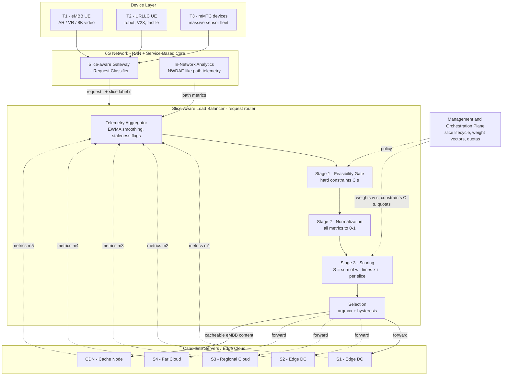
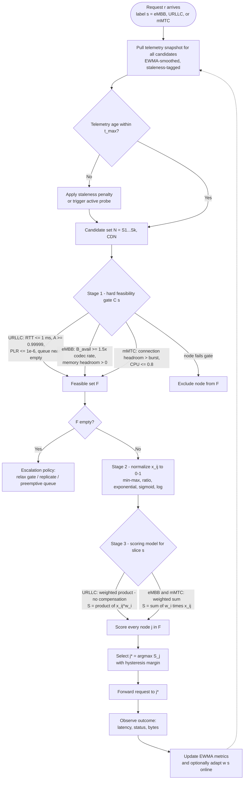
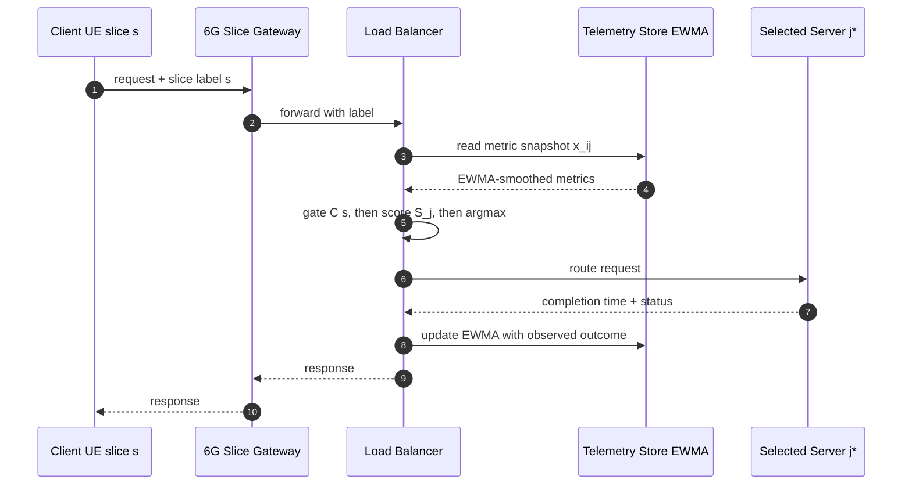
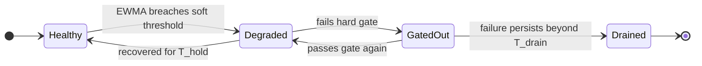

You're right — my apologies for the confusion. The earlier output was entirely in English, but I wrapped the whole document inside a raw code block, so it displayed as markup "source code" instead of rendered text (which likely made it look like a foreign language). Below is the **same complete research document, fully in English, in properly rendered Markdown, with live Mermaid flowcharts**. If your environment supports Mermaid (GitHub, VS Code, Typora, Obsidian), the diagrams will render directly. You can also copy everything into a `.md` file.

---

# Slice-Aware Load Balancing and Request Routing for 6G Network Slicing
## A Multi-Parameter Scoring Framework for eMBB, URLLC, and mMTC

**Document type:** Research report / system design
**Scope:** The load balancer (LB) / request-routing component of a 6G network slicing architecture
**Premise:** Incoming requests are already classified as `eMBB | URLLC | mMTC`
**Output:** A per-candidate-server routing score that selects the best server per request

---

## Abstract

Classical load balancers (least connections, weighted round robin) pursue pure load dispersion and implicitly assume all requests are homogeneous. 6G network slicing breaks that assumption: eMBB, URLLC, and mMTC have fundamentally different — and partly non-commensurable — QoS envelopes [1], [2]. This report investigates the routing parameters the load balancer should measure for each candidate server, explains how each parameter affects the three slice types differently, defines normalization schemes mapping heterogeneous metrics onto a common 0–1 scale, and proposes a two-stage routing decision: **hard feasibility gate (Stage 1) → per-slice weighted multi-criteria score (Stage 2)**. With this, URLLC requests are served by low-risk nodes, eMBB by high-throughput nodes, and mMTC bursts spread across nodes with connection capacity headroom — instead of simply sending every request to the least-loaded server.

---

## 1. Background and Problem Statement

### 1.1 Context: 6G and network slicing

Network slicing divides shared infrastructure (RAN, transport, edge/core cloud) into isolated logical networks, each optimized per service category [3], [7], [8]. ITU defined the three foundational service classes for IMT-2020 [1]; the IMT-2030 (6G) framework retains enhanced versions of them while adding immersive XR, integrated sensing, and AI-communication scenarios [2]:

- **eMBB** — Enhanced Mobile Broadband: high-throughput, high-bandwidth traffic (8K video, AR/VR, holographic-class media).
- **URLLC** — Ultra-Reliable Low-Latency Communication: industrial control, V2X, remote surgery, haptics.
- **mMTC** — Massive Machine-Type Communication: sensor/actuator fleets at 10⁶–10⁸ devices/km² [2], [5], [6].

The 5G/6G service-based core (e.g., the NSSF) decides *which slice* handles a request [3]. **This report addresses the next granularity level: within a slice, which server/edge node handles each individual request.** The LB is thus the "last decision mile" that carries slice-awareness from the control plane down to execution nodes.

### 1.2 QoS envelopes (design constraints)

| KPI | eMBB | URLLC | mMTC | Source |
|---|---|---|---|---|
| Peak data rate | multi-Gbps → 50–200 Gbps (6G indicative) | — | — | [2] |
| User-experienced rate | 100 Mbps → 300–500 Mbps | — | — | [2] |
| E2E latency | ~10 ms class | 1 ms class (5G target 0.5 ms user-plane) → ~0.1 ms (6G indicative) | relaxed (seconds) | [2], [4] |
| Reliability | ~99.9% | 1−10⁻⁵ (5G) → toward 1−10⁻⁷ (6G indicative) | per-message tolerant | [2], [4] |
| Jitter | moderate (absorbed by buffers) | critical (determinism) | low impact | [12] |
| Connection density | moderate | low–moderate | 10⁶/km² (5G min.) → 10⁸/km² (6G indicative) | [2], [5] |
| Traffic pattern | long-lived, high-bitrate flows | short, event/periodic payloads | massive small, bursty payloads | [1], [12] |

**Key insight:** because slice objectives are non-commensurable, no single "least-loaded server" scalar is optimal for all slices. The routing score must be a *per-slice function*.

### 1.3 Problem statement

Formally, let:

- `r` = incoming request, pre-labeled with slice type `s ∈ {eMBB, URLLC, mMTC}`
- `N = {j₁ … jₙ}` = candidate servers/edge nodes (e.g., S1–S4 + CDN in your sketch)
- `x_ij` = the latest (EWMA-smoothed) value of parameter `i` on node `j`, for `i = 1 … k`
- `C(s)(·)` = per-slice hard-constraint (gate) predicates
- `w(s) = (w₁ … w_k)` = per-slice weight vector, with Σ wᵢ = 1
- `x̂_ij ∈ [0,1]` = the normalized value of parameter `i` on node `j`

The routing decision is:

> **j\* = argmax over j ∈ F(s) of S_j(s)**, where **F(s) = { j ∈ N : the gate C(s) passes for j }**

where `S_j(s)` is a per-slice weighted scoring function (Section 7). **The goal is not least-loaded, but least-risk-within-slice-constraints load dispersion [14], [15].**

### 1.4 Interpretation note

Item 6 in your prompt was truncated ("Whether it should…"). It is interpreted here as **"whether the parameter should act as a hard admission constraint (gate) or as a soft weighted factor in the score — and for which slice type."** Every parameter card answers this explicitly. Measurement cadence (static / semi-static / dynamic telemetry) is treated in §3.3.

### 1.5 Assumptions

1. Classification happens before the load balancer (as stated).
2. The LB sits at the edge-site gateway (or as a distributed anycast service) [9], [10]; candidates include edge servers, regional cloud, and CDN cache nodes.
3. Candidates export metrics via a telemetry plane (push/pull), analogous to NWDAF-style analytics in the 6G management plane [22].
4. The decision-time budget is tight: for URLLC, scoring overhead must be microseconds → precomputed in-memory EWMA snapshots, lock-free reads.

---

## 2. System Architecture

### 2.1 Reference architecture



### 2.2 Mapping to your sketch architecture

| Your sketch element | Counterpart in this framework |
|---|---|
| Devices T-1, T2, T3 (eMBB / mMTC / URLLC) | Device layer; requests carry a slice label into the LB |
| "6G Network Slicing" + classification | Slice-aware gateway / classifier (the input edge of the LB) |
| LB node | Two-stage decision engine: **Gate → Normalize → Score → Select** |
| S1–S4, CDN | Candidate node set N, including cache/compute edge nodes |
| Caching / Computation | Scored via P15 (cache hit) and P16/P3 (compute capacity) |
| "Parameters → Selection" | Metric vector x·j → feasible set F(s) → score S_j(s) |
| "Weighted average (score)" | Weighted sum / weighted product with per-slice weights w(s) (Section 7) |

### 2.3 Load balancer deployment options

- **Centralized edge-gateway LB** — single decision point; simple state, globally consistent scoring; must be failure-resilient.
- **Distributed anycast LB** — identical scoring logic in multiple points of presence; geographic proximity becomes an implicit variable; no single point of failure.
- **Hierarchical** — intra-site LB (fast, local) with inter-site spillover when overloaded; the inter-site layer uses the same framework one level up.

---

## 3. Routing Decision Workflow

### 3.1 Decision flowchart



### 3.2 Request lifecycle (sequence view)



### 3.3 Telemetry plane and metric freshness

| Cadence class | Examples | Update period |
|---|---|---|
| Static | Node throughput capacity, geographic location, hardware profile | days/weeks |
| Semi-static | Slice resource quota, health/thermal state, availability class | minutes |
| Dynamic | CPU/memory utilization, queue length, active connections, response time | 100 ms–1 s push (EWMA, α ∈ 0.1–0.5) |
| On demand | Active-probe RTT / jitter / loss | periodic or on trigger |

**Staleness penalty.** A stale metric is worse than none — it scores dead nodes with unwarranted confidence. Apply a multiplicative decay x̂′ = x̂ · e^(−λ·Δt) where Δt is metric age; for URLLC, burst-probe candidates. This freshness notion parallels Age of Information concerns in mMTC telemetry.

### 3.4 Node admission state (oscillation control)



Hysteresis (hold time `T_hold`, switch margin `δ`, drain time `T_drain`) prevents a flapping node from oscillating in and out of the gate and generating routing churn — the classic herd/oscillation failure of naive least-loaded schemes [14].

---

## 4. Parameter Taxonomy (Overview)

| ID | Parameter | Symbol | Direction | Preferred normalization | eMBB role | URLLC role | mMTC role |
|----|-----------|--------|-----------|--------------------------|-----------|------------|-----------|
| P1 | CPU utilization | u_cpu | minimize | sigmoid, knee 0.7 | S·M | S·H + G | S·M + G |
| P2 | Memory utilization | u_mem | minimize | 1−u; swap flag | S·M | S·M + G(swap) | S·M |
| P3 | GPU/NPU accelerator availability | a_acc | maximize | free fraction | S·H (AI/AR) | S·M | S·L |
| P4 | Queue length / backlog | q | minimize | e^(−q/q₀) | S·M | S·H + G | S·H |
| P5 | Active requests / connections | c | minimize | headroom | S·M | S·M | S·H + G |
| P6 | Composite load index | L | minimize | min–max on cluster | S | S | S (P2C sampling) |
| P7 | Available bandwidth | B_av | maximize | B_av/B_cap | S·H + G | S·M | S·L |
| P8 | Network latency / RTT | d_net | minimize | e^(−t/τ_s) | S·M | G + S·H | S·L |
| P9 | Jitter | J | minimize | e^(−J/τ_J) | S·M | S·H | — |
| P10 | Packet-loss rate | p | minimize | log scale | S·M | G + S·H | S·L |
| P11 | Hop count / path length | h | minimize | min–max | S·L | S·M | — |
| P12 | Client–server distance / propagation | d | minimize | e^(−d/d₀) | S·M | G + S·H | — |
| P13 | Observed response time | t_resp | minimize | SLA ratio | S·M | S·H | S·L |
| P14 | Database latency | t_db | minimize | SLA ratio | S·M | S·M + G | S·L |
| P15 | Cache hit ratio / content locality | h_c | maximize | native 0–1 | S·H | S·L | — |
| P16 | Throughput capacity (bps / pps) | G | maximize | min–max on cluster | S·H | S·L | S·M (pps) |
| P17 | Availability | A | maximize | nines mapping | G ≥ 0.99 | G ≥ 0.99999 | G ≥ 0.99 |
| P18 | Reliability (PDR / MTBF) | R | maximize | log scale | S·M | G + S·H | S·M |
| P19 | SLA-compliance history | ρ_sla | maximize | EWMA ratio | S·M | S·H | S·M |
| P20 | Connection capacity headroom | κ | maximize | headroom | S·L | S·M | S·H + G |
| P21 | Energy efficiency | η_E | maximize | η_j/η_max | S·L | — | S·H |
| P22 | Node health (thermal, errors) | H_node | maximize | 1 − max(·) | S·L + G | S·M + G | S·M |
| P23 | Slice quota & isolation | Q_s | maximize | free-quota fraction | S·M | G + S·H | S·M + G |

**Legend:** S = soft scoring factor; G = hard gate; H/M/L = typical weight class for that slice; — = usually excluded. Values are engineering guidance, tuned in Sections 7–8.

---

## 5. Detailed Parameter Analysis

Every card follows your six required points: (1) what it represents, (2) why it matters for load balancing, (3) how it affects eMBB/URLLC/mMTC differently, (4) maximize/minimize, (5) normalization to 0–1, (6) gate vs. score.

### 5.1 Compute and Memory (server-internal signals)

#### P1. CPU Utilization (u_cpu)

1. **Represents:** the fraction of CPU cycles in use over short windows (1 s, 60 s), ideally scoped per-container/per-slice so that slice-isolated usage is visible.
2. **Why it matters for load balancing:** CPU is the dominant bottleneck resource for most request processing. Queueing theory [13] shows mean sojourn time grows as 1/(μ − λ) — as u_cpu → 1, latency explodes non-linearly. Low utilization means remaining *burst absorption capacity*, not just idle hardware.
3. **Effect per slice:** — **eMBB:** transcoding, encryption, and rendering offload are CPU-heavy; sustained headroom sustains sustained bitrate. — **URLLC:** any CPU saturation injects millisecond-scale queue spikes that destroy the latency budget; target a soft cap (~0.6–0.7). — **mMTC:** per-device processing is tiny, but registration storms spike control-plane CPU.
4. **Direction:** minimize (cost criterion).
5. **Normalization:** naive: x̂ = 1 − u_cpu. Recommended: a sigmoid that bends at the queueing knee:

   > x̂ = 1 / (1 + e^(k·(u_cpu − u₀))), with k ≈ 10, u₀ ≈ 0.7

   This is nearly linear in the operating range and punishes near-saturation, matching the M/M/1 non-linearity.
6. **Gate vs. score:** score for all; soft gate for URLLC (u ≤ 0.7) and mMTC registration bursts (u ≤ 0.8).

#### P2. Memory Utilization (u_mem)

1. **Represents:** fraction of RAM in use, plus swap-activity indicator.
2. **Why it matters for load balancing:** memory exhaustion triggers OOM kills (an availability event), garbage-collection/swap pauses inject tens of milliseconds of stall, and cache eviction hurts throughput. Memory headroom governs admission of large buffers.
3. **Effect per slice:** — **eMBB:** high-bitrate stream buffers and edge caches are memory-hungry; eviction directly lowers cache hit (P15). — **URLLC:** GC/swap pauses are catastrophic (a millisecond stall exceeds the entire budget); a swapping node is effectively URLLC-ineligible. — **mMTC:** per-device connection state consumes memory, so headroom proxies scalability.
4. **Direction:** minimize.
5. **Normalization:** x̂ = 1 − u_mem; if swap activity > 0, force x̂ = 0 (or trip a gate).
6. **Gate vs. score:** score for all; hard gate "no swap and u_mem ≤ 0.8" for URLLC.

#### P3. GPU / NPU Accelerator Availability (a_acc)

1. **Represents:** 6G is intended to be AI-native [11], [24]; nodes may host GPUs/NPUs that inference tasks (AR rendering, semantic communication, channel prediction, LLM serving) compete for.
2. **Why it matters for load balancing:** when the workload is inference-heavy, accelerators are frequently the scarce resource; routing to a node with free acceleration can be orders of magnitude faster than an idle-CPU node.
3. **Effect per slice:** — **eMBB:** AR/VR and generative-media rendering benefit massively from GPU offload. — **URLLC:** AI-based prediction must meet real-time deadlines; deterministic accelerator time-slices matter. — **mMTC:** fleet-scale lightweight inference benefits, lower priority.
4. **Direction:** maximize availability/headroom (minimize utilization).
5. **Normalization:** x̂ = (acc_cap − acc_used) / acc_cap; if the request needs no acceleration, drop the metric from the vector.
6. **Gate vs. score:** score only for acceleration-demanding requests (workload-aware filtering); excluded otherwise to avoid diluting the score.

#### P4. Queue Length / Backlog (q)

1. **Represents:** jobs waiting in the OS run queue, NIC rings, application thread pool, or the slice's admission queue.
2. **Why it matters for load balancing:** queue length is the most direct predictor of *imminent wait*: W ≈ q/μ. It predicts overload faster than utilization, because it counts actual backlog rather than work intensity.
3. **Effect per slice:** — **URLLC:** dominant internal factor — every queued packet directly consumes the 1 ms budget; target near-zero backlog. — **eMBB:** client playout buffers absorb moderate queueing. — **mMTC:** growing queues are the early-warning of registration-storm overload.
4. **Direction:** minimize.
5. **Normalization:** headroom form x̂ = max(0, 1 − q/q_max); or queueing-aware x̂ = e^(−q/(μ·τ_s)), measuring backlog in *service-rate units* [13] (τ_s = per-slice wait tolerance).
6. **Gate vs. score:** score for all; hard gate for URLLC (q ≤ small critical bound).

#### P5. Active Requests / Concurrent Connections (c)

1. **Represents:** in-flight requests or active sessions (application-level; distinct from TCP table entries).
2. **Why it matters for load balancing:** the classic least-connections signal [17]; it measures *instantaneous contention*. Paired with capacity (P20) it yields per-request resource headroom.
3. **Effect per slice:** — **eMBB:** long-lived flows; fairness matters (new flows must not starve behind old ones). — **URLLC:** counts are low, but each must be served instantly; high counts imply per-request time-slicing before the deadline. — **mMTC:** connection count *is* the scaling metric — a node holding 400 k devices vs 40 k is a categorical difference.
4. **Direction:** minimize, always relative to capacity.
5. **Normalization:** x̂ = (c_max − c)/c_max (headroom form).
6. **Gate vs. score:** score for all; hard gate for mMTC (headroom > expected burst size, Section 8).

#### P6. Composite Load Index (L)

1. **Represents:** a weighted combination of CPU, memory, and queue (optionally disk and network) utilization — e.g., an OS load average or a datacenter health score.
2. **Why it matters for load balancing:** a single summary reduces telemetry overhead from k metrics to 1, which is what "power-of-two-choices" (P2C) sampling [15] needs to work with O(1) state.
3. **Effect per slice:** the mixture weights should follow the slice: throughput-centric (eMBB), queue-centric (URLLC), connection-centric (mMTC).
4. **Direction:** minimize.
5. **Normalization:** x̂ = 1 − L/L_max, or min–max over the observed cluster range.
6. **Gate vs. score:** score factor, or the *sole* factor in low-state regimes (P2C for mMTC); it must not replace explicit gates for URLLC.

### 5.2 Network and Path Signals

#### P7. Available Bandwidth / Link Utilization (B_av)

1. **Represents:** residual capacity on access, backhaul, and core paths toward the candidate node.
2. **Why it matters for load balancing:** the direct determinant of achievable throughput; it is the scoring driver for IMT-2030 user-experienced-rate and area-capacity KPIs [2]. A saturated link also destroys latency indirectly (queueing).
3. **Effect per slice:** — **eMBB:** dominant; insufficient bandwidth forces mid-stream rebuffering. — **URLLC:** payloads are small, but residual capacity is needed so packets never transiently queue; reserved capacity beats merely idle capacity. — **mMTC:** tiny per-flow rates, but aggregate uplink is the constrained resource.
4. **Direction:** maximize.
5. **Normalization:** x̂ = B_av/B_cap; or slice-anchored x̂ = min(1, B_av/B_req(s)), so that overloaded nodes all saturate to 1 and tie-breaking falls to other criteria.
6. **Gate vs. score:** score for all; soft gate for eMBB (B_av ≥ 1.5× instantaneous codec rate, for burst headroom).

#### P8. Network Latency / RTT (d_net)

1. **Represents:** round-trip or one-way delay from client→LB→node, decomposed into propagation, transmission, queueing, and processing.
2. **Why it matters for load balancing:** the *floor* of achievable latency for every candidate, independent of load; the quantity 5G URLLC targets (0.5 ms user-plane [4]) and 6G indicative figures (~0.1 ms [2]) speak to. An LB can balance load, but not the speed of light.
3. **Effect per slice:** — **URLLC:** dominant; a 1 ms-class budget has no room for a 20 ms path. — **eMBB:** affects startup and interactivity (cloud gaming), tolerates tens of ms. — **mMTC:** relaxed except during registration deadlines.
4. **Direction:** minimize.
5. **Normalization:** per-slice exponential decay:

   > x̂ = e^(−d_net/τ_s), with τ_URLLC ≈ 1 ms, τ_eMBB ≈ 20 ms, τ_mMTC ≈ 200 ms

   The exponential form keeps high discrimination *inside* the slice's budget and flattens into a penalty beyond it — exactly the desired shape.
6. **Gate vs. score:** hard gate for URLLC (RTT ≤ 1–5 ms depending on deployment); score for eMBB/mMTC.

#### P9. Jitter (J)

1. **Represents:** the variance of delay (std or IQR of RTT samples).
2. **Why it matters for load balancing:** jitter is the *determinism* signal: a 1 ms mean with 3 ms jitter does not satisfy a URLLC budget in the tail [12]. It also sizes playout buffers for streaming.
3. **Effect per slice:** — **URLLC:** critical — determinism outranks raw speed ("ultra-reliable" means bounded tails). — **eMBB:** absorbed by playout buffers but degrades interactive liveness. — **mMTC:** mostly irrelevant.
4. **Direction:** minimize.
5. **Normalization:** x̂ = e^(−J/τ_J), with per-slice τ_J (e.g., 100 µs for URLLC).
6. **Gate vs. score:** score; optional URLLC gate (J ≤ J_max).

#### P10. Packet-Loss Rate (p)

1. **Represents:** fraction of packets lost or errored on the path to the node and within the node.
2. **Why it matters for load balancing:** loss triggers retransmission (inflating latency) and erodes effective throughput; it is the path component of reliability (URLLC: 1−10⁻⁵, toward 1−10⁻⁷ [2], [4]).
3. **Effect per slice:** — **URLLC:** critical — a lost control packet can consume the whole budget in retransmission. — **eMBB:** ARQ/FEC masks video loss, but sustained loss erodes effective bitrate. — **mMTC:** individual packets are cheap and tolerated; high loss breaks registration storms.
4. **Direction:** minimize.
5. **Normalization:** log scale is preferred, since URLLC cares about orders of magnitude (10⁻² vs 10⁻⁶ vs 10⁻⁹):

   > x̂ = (log₁₀ p_max − log₁₀ max(p, p_min)) / (log₁₀ p_max − log₁₀ p_min), with p_min = 10⁻⁹, p_max = 10⁻¹

6. **Gate vs. score:** hard gate for URLLC (p ≤ 10⁻⁶); score for the others.

#### P11. Hop Count / Path Length (h)

1. **Represents:** number of L2/L3 hops between client and candidate.
2. **Why it matters for load balancing:** each hop adds delay and jitter and — multiplicatively — reduces end-to-end reliability: P_success = (1 − p)^h.
3. **Effect per slice:** — **URLLC:** fewer hops → higher determinism and reliability. — **eMBB:** moderate. — **mMTC:** affects aggregation backhaul cost, minor.
4. **Direction:** minimize.
5. **Normalization:** x̂ = (h_max − h)/(h_max − h_min).
6. **Gate vs. score:** score / tie-breaker, never the gate (P8 already captures its effect).

#### P12. Client–Server Distance / Propagation Delay (d)

1. **Represents:** geographic distance, which imposes a hard propagation floor: ≈ 5 µs/km one-way in fiber (≈ 10 µs/km RTT).
2. **Why it matters for load balancing:** latency budgets are bounded by physics regardless of load; it is the fundamental reason to anchor URLLC at the near edge and heavy eMBB content at CDN nodes [9], [10].
3. **Effect per slice:** — **URLLC:** the dominant *placement* constraint: a 1 ms RTT budget restricts reachable nodes to a few tens of km. — **eMBB:** affects CDN proximity for stream startup. — **mMTC:** negligible per device; constrains the cluster's backhaul.
4. **Direction:** minimize.
5. **Normalization:** x̂ = e^(−d/d₀) with per-slice d₀ (e.g., 10 km URLLC, 500 km eMBB).
6. **Gate vs. score:** gate for URLLC (d ≤ d_max); score for eMBB. In practice prefer measured RTT (P8), which subsumes hop effects; distance serves as the static fallback when RTT probing is unavailable.

### 5.3 Application and Data Signals

#### P13. Observed Response Time (t_resp)

1. **Represents:** EWMA (and p95/p99) of end-to-end service time of the last k completed requests of this slice on this node.
2. **Why it matters for load balancing:** a *black-box* SLA signal that covers CPU, queueing, locks, GC, and backend calls — it captures what the devices fail to model, and it directly feeds SLA compliance.
3. **Effect per slice:** — **URLLC:** the direct KPI; the tail (p99.9) matters more than the mean [12]. — **eMBB:** drives startup and stall ratios. — **mMTC:** batch completion time.
4. **Direction:** minimize.
5. **Normalization:** SLA-ratio form x̂ = min(1, t_SLA(s)/t_resp) — a node beyond SLA clamps to 0, and 0 then means "SLA-violating."
6. **Gate vs. score:** score; persistent SLA violations feed P19 and the gating state machine.

#### P14. Database Latency (t_db)

1. **Represents:** p50/p95 read and write latency of the backing data store(s) used by the node.
2. **Why it matters for load balancing:** most services are database-bound; a node with healthy CPUs but a degraded backend still exhibits long response times. The LB should avoid nodes (or node groups sharing a backend) whose database is the bottleneck.
3. **Effect per slice:** — **URLLC:** state lookups must be microsecond-class (in-memory/local) — a remote-database touch is often infeasible. — **eMBB:** session and content-metadata lookups. — **mMTC:** aggregate telemetry writes; registration write storms.
4. **Direction:** minimize.
5. **Normalization:** x̂ = min(1, d_SLA(s)/t_db_p95).
6. **Gate vs. score:** score; soft gate for URLLC (no degraded backend).

#### P15. Cache Hit Ratio / Content Locality (h_c)

1. **Represents:** the fraction of request content servable locally at the node (CDN/edge cache), or a per-content pre-placement indicator [9].
2. **Why it matters for load balancing:** routing the request to where the data already lives ("compute follows data") removes backhaul transfer and multiplies effective throughput — for cacheable traffic it dominates nearly every other signal.
3. **Effect per slice:** — **eMBB:** dominant (video, software delivery, game assets). — **URLLC:** relevant for session-context/state caching (state stickiness), but payloads themselves are not cacheable. — **mMTC:** payloads not cacheable; subscription/device-profile data partially.
4. **Direction:** maximize.
5. **Normalization:** native 0–1: x̂ = h_c, or a binary per-content hit indicator.
6. **Gate vs. score:** score for eMBB (high weight — this effectively steers the CDN branch in your architecture); excluded for other slices.

#### P16. Node Throughput / Processing Capacity (G)

1. **Represents:** sustainable aggregate goodput (bps) — or packets-per-second (pps), relevant for mMTC — established by benchmarking.
2. **Why it matters for load balancing:** the static complement to utilization: a 10 Gbps node at 70% has more *absolute* free capacity than a 100 Mbps node at 10%.
3. **Effect per slice:** — **eMBB:** high-capacity nodes preferred. — **URLLC:** per-request scheduling capability matters, not raw bps. — **mMTC:** pps (small-packet capability) is the correct unit, not bps.
4. **Direction:** maximize.
5. **Normalization:** min–max on the cluster: x̂ = (G_j − G_min)/(G_max − G_min).
6. **Gate vs. score:** score; static attribute refreshed only via cluster normalization.

### 5.4 Reliability and Trust Signals

#### P17. Availability (A)

1. **Represents:** historical uptime fraction plus current reachability (active health checks).
2. **Why it matters for load balancing:** the elementary admission property: a flapping node must be excluded *before* it can receive traffic — above all for URLLC (five-nines-class requirement [4]).
3. **Effect per slice:** URLLC demands the highest class; eMBB/mMTC typically tolerate 99%.
4. **Direction:** maximize.
5. **Normalization:** map the "nines" so that differences matter at high reliability:

   > x̂ = (A − A_min)/(1 − A_min), with A_min = 0.98

   (99.999% → 0.9995 vs 99.9% → 0.95 — the difference is amplified.)
6. **Gate vs. score:** hard gate for all slices, per-slice thresholds (Section 8).

#### P18. Reliability / Packet Delivery Ratio / MTBF (R)

1. **Represents:** the end-to-end successful-delivery fraction over a window (PDR), or hardware mean time between failures.
2. **Why it matters for load balancing:** the statistical raw material of ultra-reliability [12]; distinct from availability (reachability vs conditional delivery). Tail events — not the mean — define URLLC risk.
3. **Effect per slice:** — **URLLC:** dominant. — **eMBB:** moderate (FEC masks mid-level loss). — **mMTC:** device-registration reliability matters; per-sample packets are tolerated.
4. **Direction:** maximize.
5. **Normalization:** log scale on failure probability, identical to P10.
6. **Gate vs. score:** hard gate for URLLC; score for the others.

#### P19. SLA-Compliance History / Trust Score (ρ_sla)

1. **Represents:** the rolling fraction (EWMA) of this slice's requests on this node that met their SLA.
2. **Why it matters for load balancing:** closed-loop empirical feedback: it captures unmodeled effects, guards against metric gaming, and implements trust decay (nodes must *earn* traffic).
3. **Effect per slice:** all slices, with different windows (short and sensitive for URLLC, longer for eMBB).
4. **Direction:** maximize.
5. **Normalization:** x̂ = ρ_sla ∈ [0,1] natively.
6. **Gate vs. score:** score; prolonged violations auto-exclude via the P22 state machine.

### 5.5 Capacity, Energy, Health, and Isolation

#### P20. Connection Capacity Headroom (κ)

1. **Represents:** remaining concurrent-session capacity relative to connection-table/file-descriptor/session limits: κ = (c_max − c)/c_max.
2. **Why it matters for load balancing:** the mMTC scalability signal: IMT-2020 requires 10⁶ devices/km² [5], and 3GPP's CIoT study evaluated tens of thousands of devices per cell [6]; connection-table exhaustion produces hard drops, not graceful degradation.
3. **Effect per slice:** — **mMTC:** dominant. — **URLLC:** moderate (headroom also implies isolation). — **eMBB:** low (long-lived flows, moderate counts).
4. **Direction:** maximize.
5. **Normalization:** native 0–1 (headroom).
6. **Gate vs. score:** hard gate for mMTC (headroom > burst estimate); score elsewhere.

#### P21. Energy Efficiency (η_E)

1. **Represents:** energy per bit or per request (J/bit, J/request); optionally PUE and site battery state (for unattended edge sites).
2. **Why it matters for load balancing:** 6G explicitly emphasizes sustainability [2], [11]; scoring energy is nearly free at small scale and decisive at mMTC scale; thermal limits also throttle performance.
3. **Effect per slice:** — **mMTC:** high (aggregate energy at 10⁸ connections/km²). — **eMBB:** J/bit as a secondary criterion. — **URLLC:** subordinate to latency; weight ≈ 0.
4. **Direction:** maximize efficiency (or minimize consumption).
5. **Normalization:** x̂ = η_j/η_max (cluster-normalized).
6. **Gate vs. score:** score, with a high mMTC weight; battery-depleted edge sites gated out.

#### P22. Node Health — Thermal, Hardware Errors, Restarts (H_node)

1. **Represents:** temperature, hardware error rates, recent restart counts — leading indicators of component failure and silent performance loss.
2. **Why it matters for load balancing:** thermal throttling silently cuts capacity *before* the metrics saturate; error rates predict imminent failure; a predictive gate metric.
3. **Effect per slice:** all; URLLC is most sensitive (least risk-tolerant of unstable hardware).
4. **Direction:** maximize health.
5. **Normalization:** x̂ = 1 − max(normalized temperature, error rate, restart rate) — a weakest-link aggregation.
6. **Gate vs. score:** score; soft gate "temperature > threshold → no URLLC traffic."

#### P23. Slice Resource Quota and Cross-Slice Isolation (Q_s)

1. **Represents:** the remaining fraction of the quota (vCPU/RAM/PRB) reserved *for this slice* on the node, plus a contention/interference level from co-located slices.
2. **Why it matters for load balancing:** slice isolation is the lease [3], [7], [8]: routing only where *reserved* quota remains is what makes URLLC-style guarantees meaningful; an interference signal reveals noisy neighbors (oversold quota, best-effort background).
3. **Effect per slice:** — **URLLC:** critical — requires reserved, preemption-capable quota. — **eMBB:** elastic; can consume best-effort capacity. — **mMTC:** connection-table/signaling quota.
4. **Direction:** maximize free quota; minimize interference.
5. **Normalization:** x̂ = Q_free(s)/Q_total(s); interference scored separately (cost).
6. **Gate vs. score:** gate (hard for URLLC: free quota > request need) plus score.

---

## 6. Normalization Toolbox

All metrics must be mapped onto a common [0, 1] scale with direction aligned (higher = better) before scoring:

| Transform | Formula | Use for |
|---|---|---|
| Min–max (benefit) | x̂ = (x − x_min)/(x_max − x_min) | bounded metrics with known ranges in the cluster |
| Min–max (cost) | x̂ = (x_max − x)/(x_max − x_min) | same, with reversed direction |
| Capacity ratio | x̂ = (C − x)/C | utilization/occupancy measured against a known capacity (CPU, memory, connections, quota) |
| Exponential decay | x̂ = e^(−x/τ_s) | unbounded cost metrics (latency, jitter, distance); τ_s set to the *slice's* budget |
| Sigmoid | x̂ = 1/(1 + e^(k(x − x₀))) for cost | metrics with a sharp non-linear response at a threshold (queueing knee) |
| Log scale | x̂ = (log p_max − log p)/(log p_max − log p_min) | metrics spanning orders of magnitude (loss, failure probability) |
| SLA ratio | x̂ = min(1, x_SLA(s)/x) | black-box times, directly encoding compliance |
| EWMA | x̃_t = α·x_t + (1 − α)·x̃_(t−1) | telemetry smoothing before scoring; α ∈ 0.1–0.5 |
| Staleness penalty | x̂′ = x̂ · e^(−λ·Δt) | discounting stale metrics |

**Why the per-slice time constant τ_s is crucial.** A single global normalization cannot serve two objectives: a linear min–max over 0–50 ms cannot distinguish a 0.5 ms node from a 2 ms node (both ≈ 1.0), yet that distinction is the entire URLLC decision. Exponential/SLA-ratio forms, anchored to each slice's own budget, restore the needed discrimination.

---

## 7. Scoring Function Design and Weights

### 7.1 Why two stages (gate → score)

Gates encode **per-slice constraints that must hold**; the score encodes **preferences**. Mixing constraints into soft weights (a plain weighted average) lets one excellent metric compensate for one fatal metric. Lexicographic order: constraints before preferences.

### 7.2 Weighted Sum vs. Weighted Product (the compensation danger)

**Weighted sum (SAW/WSM) [18]:**  S_j(s) = Σᵢ wᵢ(s) · x̂_ij

**Weighted product (WPM):**  S_j(s) = Πᵢ (x̂_ij)^wᵢ(s)

Illustrative example (URLLC, w_lat = 0.2, four other metrics at 0.2 each):

| Node | Latency score | Other 4 scores | Weighted sum | Weighted product |
|---|---|---|---|---|
| A (near, hot) | 0.25 | 1.0 | **0.85** | 0.76 |
| B (far, stable) | 0.60 | 0.60 | 0.60 | **0.60** |

The weighted sum picks A — a node with 4× worse latency — because excellent CPU/bandwidth *compensated* for the fatal latency. The weighted product narrows the gap, and as weight shifts to latency (w_lat = 0.5 → WPM A = 0.50 vs B = 0.60) it selects B. **Recommendation: WSM for eMBB/mMTC (compensation is legitimate), WPM or a min-operator for URLLC (the weakest factor should nearly veto).** The min-operator S = minᵢ x̂_ij is the lexicographic extreme.

### 7.3 Alternative MCDM methods

- **TOPSIS** [18] — ranks nodes by distance to positive/negative ideal solutions; useful when the trade-off structure is ambiguous.
- **AHP** [19] — derives w(s) from expert pairwise comparisons; a defensible way to produce the per-slice tables.
- **Entropy weight method** (objective) — derives weights from metric dispersion (a metric with little variation across nodes is uninformative); good cross-check against AHP.
- **Fuzzy comprehensive evaluation** [20] — for vague or conflicting metrics; smooth, tunable boundaries.
- **Deep reinforcement learning** [21] — learn/adapt w(s) online to directly minimize SLA violations (a research direction, Section 10).

### 7.4 Illustrative per-slice weight vectors

A configuration baseline (to be tuned via AHP/entropy or learned [19], [21]; each column sums to 1):

| Scoring parameter | eMBB | URLLC | mMTC |
|---|---:|---:|---:|
| CPU headroom (P1) | 0.15 | 0.08 | 0.10 |
| Memory headroom (P2) | 0.05 | 0.04 | 0.05 |
| Queue headroom (P4) | 0.05 | 0.12 | 0.12 |
| Connection headroom (P5/P20) | 0.03 | 0.05 | 0.22 |
| Available bandwidth (P7) | 0.25 | 0.05 | 0.03 |
| RTT score (P8) | 0.10 | 0.20 | 0.02 |
| Jitter (P9) | 0.04 | 0.08 | 0.01 |
| Packet-loss score (P10) | 0.03 | 0.12 | 0.02 |
| Availability score (P17) | 0.03 | 0.07 | 0.05 |
| Reliability score (P18) | 0.02 | 0.10 | 0.04 |
| Response time (P13) | 0.05 | 0.05 | 0.03 |
| Database latency (P14) | 0.02 | 0.02 | 0.01 |
| Cache hit (P15) | 0.08 | 0.00 | 0.00 |
| Energy efficiency (P21) | 0.02 | 0.01 | 0.10 |
| Health (P22) | 0.02 | 0.01 | 0.02 |
| Throughput / pps capacity (P16) | 0.06 | 0.00 | 0.08 |
| Small-packet aggregation capability | 0.00 | 0.00 | 0.10 |
| **Total** | **1.00** | **1.00** | **1.00** |

Read-out confirms the intended profiles: eMBB = bandwidth/cache/throughput dominant; URLLC = latency/reliability/queue dominant; mMTC = connection capacity and aggregation dominant.

### 7.5 Stability mechanisms (anti-oscillation)

- **Hysteresis:** switch nodes only if S_j′ > S_(j* previous) + δ (prevents herd behavior [14]).
- **Power-of-two-choices (P2C)** [15]: for mMTC bursts, sample two random candidates and pick the better-scoring one — O(1) state and routing-table updates, while keeping maximum queues O(log log n) instead of O(log n); fits 10⁶+ events/s.
- **Consistent hashing for session affinity** [16]: for eMBB long-lived flows (and URLLC state stickiness), pin a session to a node; scoring then governs only *initial* placement, not per-packet re-decisions.
- **EWMA + percentiles:** means for smoothing; p95/p99 to capture tail risk for URLLC [12].

### 7.6 Routing decision (pseudocode)

```text
function ROUTE(request r, slice s):
    N ← candidate_nodes()                       # S1…Sk, CDN
    for j in N:
        m_j ← telemetry.snapshot(j)             # EWMA-smoothed, staleness-tagged
        m_j ← apply_staleness_penalty(m_j)

    # Stage 1 — hard feasibility gate
    F ← { j in N : gate(m_j, C[s]) = true }
    if F = ∅: F ← escalate(s, N)                # relax / replicate / preemptive queue

    # Stage 2 — normalization to 0–1, per-slice transforms
    x̂[j] ← normalize(m_j, s)   for j in F

    # Stage 3 — per-slice scoring
    if s = URLLC:   S[j] ← Π_i x̂[j][i] ^ w[s][i]          # weighted product
    else:           S[j] ← Σ_i w[s][i] · x̂[j][i]          # weighted sum

    # Selection with hysteresis
    j* ← argmax_j S[j], preferring the previous node unless S_new > S_prev + δ

    forward(r, j*)
    observe(r, j*)                # latency, status, bytes
    telemetry.update(j*)          # closes the control loop
```

Complexity: O(n·k) per decision — for n ≤ 50 candidates and k ≤ 20 metrics, microseconds on commodity hardware, satisfying the URLLC decision budget. P2C reduces effective n to 2 for mMTC.

---

## 8. Illustrative Gate Thresholds (per slice)

Values derived from 3GPP/ITU targets [2], [4], [5]; engineering starting points to calibrate per deployment:

| Constraint | eMBB | URLLC | mMTC |
|---|---|---|---|
| RTT (P8) | ≤ 20 ms (soft) | ≤ 1–5 ms (**hard**) | ≤ 100 ms |
| Jitter (P9) | ≤ 30 ms | ≤ 100 µs–1 ms | — |
| Packet loss (P10) | ≤ 10⁻³ | ≤ 10⁻⁶ (**hard**) | ≤ 10⁻² |
| Availability (P17) | ≥ 0.99 | ≥ 0.99999 (**hard**) | ≥ 0.99 |
| Bandwidth (P7) | ≥ 1.5 × codec rate (soft) | ≥ 5 × instantaneous payload rate | ≥ small burst rate |
| Queue (P4) | headroom > 0 | near-empty (**hard**) | > burst depth |
| Connection headroom (P20) | > 0 | > 0 + reserve | > expected registration burst (**hard**) |
| CPU (P1) | — | ≤ 0.7 (soft→hard) | ≤ 0.8 (during registration events) |
| Slice quota (P23) | > 0 | > need, preemptible (**hard**) | > signaling need |

The fallback hierarchy when F = ∅ (critical for URLLC): (a) relax the least-critical gate; (b) replicate using the second-best path (dual-path); (c) enter a reserved queue with preemption — declared explicitly rather than silently violating the SLA.

---

## 9. Evaluation Methodology

**Metrics (per slice):** mean / p95 / p99 / p99.9 end-to-end latency; SLA-violation rate; packet delivery ratio; throughput (Mbps for eMBB, events/s for mMTC); **fairness** (Jain's index [23]); load-imbalance index (σ of normalized node loads); routing churn (switches per second); energy per request; scoring overhead (µs per decision).

**Baselines:** round robin; weighted round robin [17]; least connections [17]; least-loaded (CPU); power-of-two-choices [15]; static MCDM with uniform weights (SAW/TOPSIS [18]); fuzzy MCDM [20]; DRL-learned weights [21].

**Workloads:** eMBB — long-lived flows with heavy-tailed size distribution (lognormal bitrates); URLLC — periodic + Poisson bursts with 32–256 B payloads and hard deadlines; mMTC — modulated/MMPP registration storms (10⁴–10⁶ simultaneous devices). Cross-validate simulated latencies against M/M/1 and M/G/1 models [13].

**Tools:** discrete-event simulation (SimPy / ns-3 / EdgeCloudSim-class) plus a containerized testbed (Kubernetes + gRPC LB + Prometheus telemetry).

**Analysis:** sensitivity analysis on weight vectors; parameter-ablation study (remove metric classes, measure SLA-violation delta); parameter importance via entropy weights or SHAP; statistical significance (ANOVA with Bonferroni correction).

---

## 10. Research Gaps and Future Directions

1. **Online weight learning** — bandit/RL adaptation of w(s) with safety constraints (bound on SLA regression before switching) [21]; cold-start strategies.
2. **Cross-slice interference modeling** — no standard telemetry exposes noisy neighbors; slice-scoped utilization counters (container-level, quota-level) are needed [7].
3. **RAN–edge joint scoring** — radio-side metrics (PRB utilization, RSRP, buffer status) are typically out of scope for a "first-hop" LB; a 6G LB should ingest them.
4. **Semantic/payload-aware routing** — scoring currently ignores request content (size, cacheability, inference cost); content-aware refinement is a direct extension.
5. **Predictive (digital-twin-assisted) routing** — load forecasters (LSTM/Transformer) predicting cluster overload, beating reactive EWMA by steering requests *away from* future congestion.
6. **Explainability** — auditable per-decision traces ("S2 chosen because gate passed and score 0.81 > 0.74 under w_lat = 0.2"); operator trust and bias detection.
7. **Telemetry integrity/security** — metrics can be forged (Byzantine nodes over-reporting their own health); signed telemetry and trust-weighted scoring (P19).
8. **Standardization** — slice-aware LB APIs and integration points with NWDAF [22] remain open in SDOs.

---

## 11. Conclusion

A 6G slice-aware load balancer must be three different decision-makers at once. The proposed framework achieves this with a two-stage structure: a set of **per-slice hard feasibility gates** encoding non-negotiable constraints (RTT, loss, availability, connection headroom, quota), followed by a **soft-preference score** over ~23 parameters spanning compute, network, application, reliability, capacity, energy, health, and isolation — normalized to 0–1 and combined with per-slice weights, using a weighted product for URLLC (no compensation) and a weighted sum for eMBB/mMTC (compensation legitimate). EWMA smoothing, staleness penalties, hysteresis, and P2C randomization close the control loop and make the scheme scalable without instability. The result converts "send to the least-loaded server" into "send to the most slice-appropriate feasible server" — which is precisely the decision a 6G routing layer should make.

---

## References

[1] ITU-R, "Framework and overall objectives of the future development of IMT for 2020 and beyond," Recommendation ITU-R M.2083-0, Sep. 2015.

[2] ITU-R, "Framework and overall objectives of the future development of IMT for 2030 and beyond," Recommendation ITU-R M.2160-0, Nov. 2023.

[3] 3GPP, "System architecture for the 5G system (5GS)," TS 23.501, 2018–2024.

[4] 3GPP, "Study on scenarios and requirements for next generation access technologies," TR 38.913, 2017.

[5] ITU-R, "Minimum requirements related to technical performance for IMT-2020 radio interface(s)," Report ITU-R M.2410-0, 2017.

[6] 3GPP, "Cellular system support for ultra-low complexity and low throughput Internet of Things (CIoT)," TR 45.820, 2015.

[7] X. Foukas, G. Patounas, A. Elmokashfi, and M. K. Marina, "Network slicing in 5G: Survey and challenges," *IEEE Communications Magazine*, vol. 55, no. 5, pp. 94–100, May 2017.

[8] NGMN Alliance, "Description of network slicing concept," white paper, 2016.

[9] ETSI, "Multi-access Edge Computing (MEC); Framework and reference architecture," GS MEC 003, 2019.

[10] W. Shi, J. Cao, Q. Zhang, Y. Li, and L. Xu, "Edge computing: Vision and challenges," *IEEE Internet of Things Journal*, vol. 3, no. 5, pp. 637–646, Oct. 2016.

[11] W. Saad, M. Bennis, and M. Chen, "A vision of 6G wireless systems: Applications, trends, technologies, and open research problems," *IEEE Network*, vol. 34, no. 3, pp. 134–142, 2020.

[12] M. Bennis, M. Debbah, and H. V. Poor, "Ultrareliable and low-latency wireless communication: Tail, risk, and scale," *Proceedings of the IEEE*, vol. 106, no. 10, pp. 1834–1853, Oct. 2018.

[13] L. Kleinrock, *Queueing Systems, Volume 1: Theory*. New York, NY: Wiley, 1975.

[14] V. Cardellini, M. Colajanni, and P. S. Yu, "Dynamic load balancing on web-server systems," *IEEE Internet Computing*, vol. 3, no. 3, pp. 28–39, 1999.

[15] M. Mitzenmacher, "The power of two choices in randomized load balancing," *IEEE Transactions on Parallel and Distributed Systems*, vol. 12, no. 10, pp. 1094–1104, 2001.

[16] D. Karger, E. Lehman, T. Leighton, M. Levine, D. Lewin, and R. Panigrahy, "Consistent hashing and random trees: Distributed caching protocols for relieving hot spots on the World Wide Web," in *Proc. ACM STOC*, 1997.

[17] W. Zhang, "Linux virtual servers for scalable network services," in *Proc. Ottawa Linux Symposium*, 2000.

[18] C.-L. Hwang and K. Yoon, *Multiple Attribute Decision Making: Methods and Applications*. Berlin, Germany: Springer, 1981.

[19] T. L. Saaty, *The Analytic Hierarchy Process*. New York, NY: McGraw-Hill, 1980.

[20] L. A. Zadeh, "Fuzzy sets," *Information and Control*, vol. 8, no. 3, pp. 338–353, 1965.

[21] H. Mao, M. Alizadeh, I. Menache, and S. Kandula, "Resource management with deep reinforcement learning," in *Proc. ACM HotNets*, 2016.

[22] 3GPP, "Architecture enhancements for 5G system (5GS) to support network data analytics services," TS 23.288.

[23] R. Jain, D.-M. Chiu, and W. Hawe, "A quantitative measure of fairness and discrimination for resource allocation in shared computer systems," DEC Research Report TR-301, 1984.

[24] K. B. Letaief, Y. Shi, J. Lu, and J. Lu, "Edge artificial intelligence for 6G: Opportunities, challenges, and prospects," *IEEE Wireless Communications*, vol. 28, no. 5, pp. 112–119, 2021.

---

**Note:** All 4 diagrams (architecture, decision flowchart, sequence, and state machine) use Mermaid and render on GitHub, VS Code, Typora, and Obsidian. Gate thresholds and weight vectors are illustrative starting points — calibrate them against your measured data.

If you'd like, I can next: **(a)** derive the AHP pairwise-comparison matrices to formally justify the §7.4 weights, **(b)** provide a Python reference implementation of the scoring engine for simulation, or **(c)** convert this into a LaTeX/IEEE conference-paper version.
